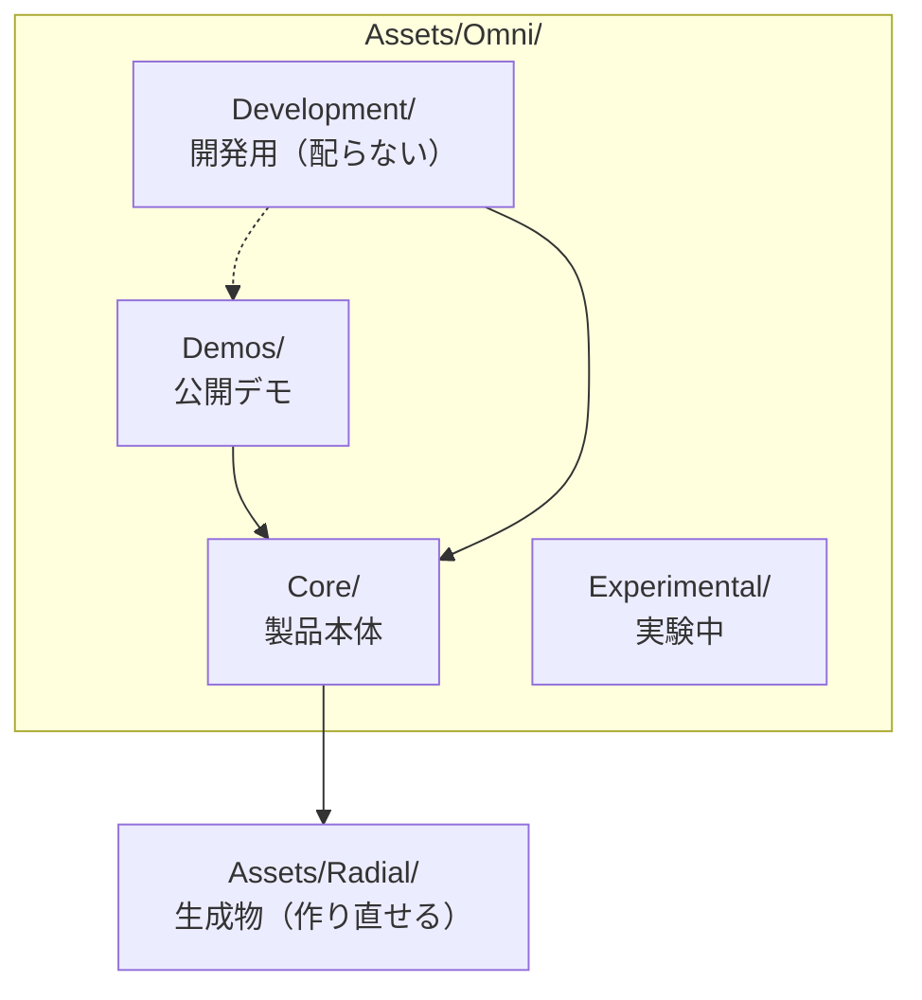

# フォルダの地図

**結論**：Omni のリポジトリは、**製品（Core）**、**デモ（Demos）**、**実験（Experimental）**、**開発用（Development）**、**生成物（Assets/Radial）** に分かれています。
Earth と Asteria は「開発用」の中にあり、まだ製品のデモとしては配っていません。



矢印は「使う」向きです。製品本体（Core）は、デモや開発用の物を使いません。

## 各フォルダ

| フォルダ | 中身 | 配るか |
|---|---|---|
| `Assets/Omni/Core/` | 製品本体。`Runtime`（Logical・Radial・BRG）、`Converter`（変換器）、`Editor`、`Verification`（購入者が自分で確かめる Scene）、`VirtualGeometry`、`Streaming` など | パッケージ `com.omni.rendering` として配る |
| `Assets/Omni/Demos/` | 公開デモ：EarthToMoon、SolarSystem、CosmicScale、Moon。共有部品 `Shared` | 別のパッケージで配る |
| `Assets/Omni/Experimental/` | 実験中の機能（DotsRadial、Exploration） | 一部だけ |
| `Assets/Omni/Development/` | 開発専用：テスト、確認用 Scene、旧デモ、**Earth**、**Asteria** など | 配らない |
| `Assets/Radial/` | 変換で作ったシェーダーなど。プロジェクトごとに作り直す | 配らない（Git にも入れない） |
| `ProjectSettings/Omni/Generated.manifest.json` | 生成物の GUID 台帳 | Git に入れる |
| `Assets/Scenes/` など | URP 3D Sample から持ってきた、取り込み確認用の素材 | 配らない |

## Earth デモの中身

```text
Assets/Omni/Development/Earth/
  Earth.unity        … Scene（Editor/EarthSceneBuilder.cs が作る）
  Runtime/           … 移植してよい部品（アセンブリ Omni.Earth.Runtime）
    Planet/            地形（EarthSurfaceSetup、高さの計算）
    Sky/               空・大気・雲（EarthSkyRenderer）
    Ground/            岩と木（EarthGroundScatter）
    Region/            アルプスの細かい標高・川・湖
    VirtualObject/     カメラの高さに応じた表現の段（EarthCameraStages）
  Scene/             … この Scene 専用（アセンブリ Omni.Earth.Demo。EarthOrbitCamera）
  Editor/            … Scene の組み立て、撮影
  Data/Alps/         … アルプスの標高・川・湖のデータ
  Shaders/ Materials/ Textures/
```

「Runtime」と「Scene」が分かれているのは、**地球の部品だけを他のデモ（EarthToMoon や SolarSystem）へ移せるように**するためです。
カメラ操作のような「この Scene だけの物」は `Scene/` に置いています。

## 名前の決まり

- 製品本体の C# とシェーダーには、フォルダのパスを直接書きません。
  開発中は `Assets/Omni/Core`、利用者の手元では `Packages/com.omni.rendering` に置かれるためです（`OmniProductPaths` で解決）。
- デモどうしは、お互いのコードを使いません。Earth のコードは Asteria を使わず、Asteria も Earth を使いません。
