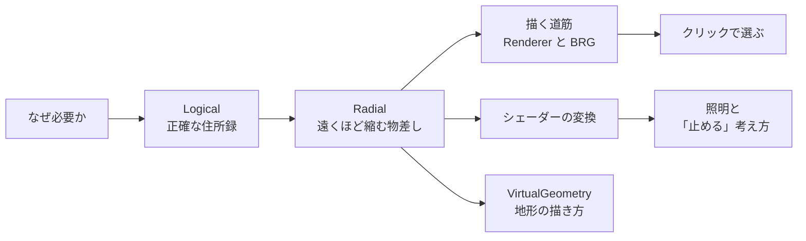

# Omni の基本

この章では、Omni 本体の仕組みを 1 つずつ説明します。
どのページも「困りごと → 原因 → Omni の直し方」の順に書いています。

| ページ | 一言で |
|---|---|
| [なぜ必要か](why.md) | Unity の `float` では、遠くで物が震え、奥行きが入れ替わる |
| [Logical](logical.md) | 位置を 192 ビットで正確に覚える。`Transform` は表示用の写し |
| [Radial](radial.md) | 遠くほど縮めて、1 台のカメラ・1 枚の奥行きで描く |
| [描く道筋](rendering-paths.md) | ふつうの Renderer と、まとめて描く BRG の 2 通り |
| [シェーダーの変換](shader-conversion.md) | 今あるシェーダーを Radial 用に作り直す。元にも戻せる |
| [照明と「止める」考え方](lighting.md) | 正しく照らせないときは、それらしい絵を出さずに止める |
| [クリックで選ぶ](picking.md) | 「当たった」「外れた」「分からない」を区別する |
| [VirtualGeometry](virtual-geometry.md) | 惑星の地形を、見える大きさに合わせて細かくして描く |
| [フォルダの地図](folders.md) | どこに何があるか。製品とデモと開発用の区別 |

!!! tip "すでに知っている部品"
    `RadialCamera` と `Logical.Transform`（Inspector では Logical Transform）は、
    この章の [Logical](logical.md) と [Radial](radial.md) で、仕組みの側から説明し直しています。
