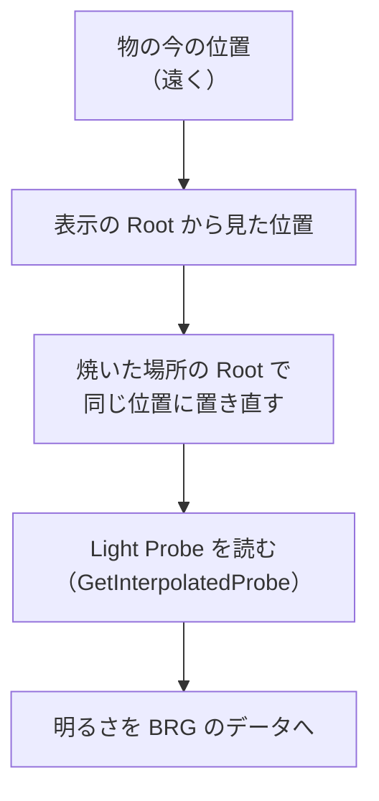
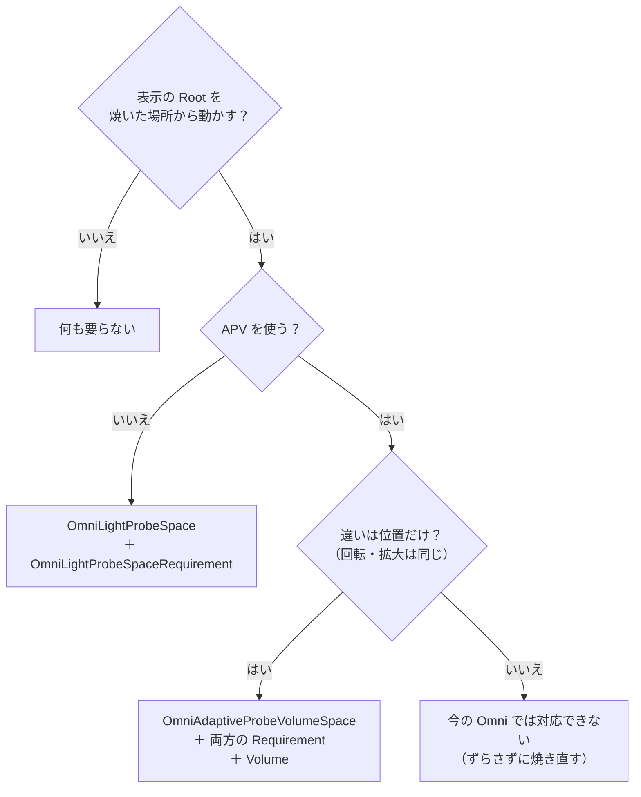

# 照明の空間をそろえる部品

**結論**：焼き込んだ照明（Light Probe や APV）は、**焼いた場所**で読まないと正しい明るさになりません。
Omni では物を描く位置が動くことがあるので、「今の位置」を「焼いた場所」へ戻してから読む部品を使います。

| 部品 | ひとことで | 付ける場所 |
|---|---|---|
| [`OmniLightProbeSpace`](#omnilightprobespace) | Light Probe を、焼いた場所に戻して読む | 表示の Root（動く親） |
| [`OmniLightProbeSpaceRequirement`](#requirement) | 「この Root には上の部品が要る」という約束 | 同じ Root |
| [`OmniAdaptiveProbeVolumeSpace`](#omniadaptiveprobevolumespace) | APV を、焼いた場所に戻して読む | 同じ Root（Volume も付ける） |
| [`OmniAdaptiveProbeVolumeSpaceRequirement`](#requirement) | 「この Root には APV の部品が要る」という約束 | 同じ Root |
| [`OmniLightingSpace`](#omnilightingspace) | Logical の正確な住所と、焼き込み用の小さな空間を行き来する | 照明の検証用の物 |
| （部品なし） | [Lightmap は物に貼り付いて、部屋と一緒に動く](#lightmap) | — |

手順は [使い方：Light Probe と APV を正しく読む](../guides/light-probe-space.md) を、名前の一覧は [API リファレンス](../api/Omni.Lighting.md) を見てください。

## 困りごと：動かした場所で、焼いた明るさを読んでしまう

### 焼き込みとは

Light Probe は、部屋のあちこちに置く「明るさのメモ」です。
Unity の Bake（焼き込み）を押すと、各メモに「ここは右から赤い光が来る」のような情報が書き込まれます。
動く物は、近くのメモを混ぜて自分の明るさを決めます。
APV（Adaptive Probe Volume）は、このメモを自動で格子状に並べる仕組みです。

### 何が困るか

Unity の焼き込みは `float` の位置で計算します。遠くでは精度が足りないので、**原点の近く（安全域 1 万 m の内側）で焼きます**。
ところが Omni のゲームでは、その部屋を**遠くの場所へ動かして描く**ことがあります。たとえば、巨大な宇宙の中の基地です。

部屋を動かしても、焼いたメモは原点の近くに残ったままです。
すると物は、**自分の今の位置の近くでメモを探して、見つけられません**。
その結果、明るさが空っぽの色（周りの空の色だけ）になったり、別の場所の色になったりします。

<figure class="caption">
<svg class="fig" viewBox="0 0 720 300" width="720" role="img" aria-label="焼いた場所と表示の場所がずれると、Light Probe を読めない">
  <rect x="20" y="40" width="250" height="170" rx="12" class="a" stroke-width="2"/>
  <text x="145" y="28" text-anchor="middle" font-size="15" font-weight="700">焼いた場所（原点の近く）</text>
  <circle cx="70" cy="90" r="9" class="fc"/><circle cx="145" cy="90" r="9" class="fc"/><circle cx="220" cy="90" r="9" class="fc"/>
  <circle cx="70" cy="160" r="9" class="fc"/><circle cx="145" cy="160" r="9" class="fc"/><circle cx="220" cy="160" r="9" class="fc"/>
  <text x="145" y="236" text-anchor="middle" font-size="13" class="muted">● Light Probe（明るさのメモ）</text>
  <rect x="450" y="40" width="250" height="170" rx="12" class="b" stroke-width="2" stroke-dasharray="6 4"/>
  <text x="575" y="28" text-anchor="middle" font-size="15" font-weight="700">今描いている場所（遠く）</text>
  <rect x="555" y="110" width="40" height="40" rx="4" class="b" stroke-width="2"/>
  <text x="575" y="180" text-anchor="middle" font-size="13">動く物</text>
  <text x="575" y="236" text-anchor="middle" font-size="13" class="muted">近くにメモが無い</text>
  <path d="M 545 130 C 450 130 360 130 280 130" class="ink" stroke-width="2" marker-end="url(#arrowLps)"/>
  <text x="410" y="118" text-anchor="middle" font-size="13">部品が位置を戻す</text>
  <text x="410" y="270" text-anchor="middle" font-size="14">部品が無いと、物は右の場所でメモを探して失敗する。</text>
  <defs><marker id="arrowLps" viewBox="0 0 10 10" refX="9" refY="5" markerWidth="8" markerHeight="8" orient="auto-start-reverse"><path d="M0,0 L10,5 L0,10 z" class="fc"/></marker></defs>
</svg>
<figcaption>部屋（表示の Root）を動かしても、焼いた明るさのメモは原点の近くに残る。部品は、物の位置を「焼いた場所」へ戻してからメモを読む。</figcaption>
</figure>

### 直し方の考え方

動かした部屋の親（**表示の Root**）に部品を付けます。部品は次の計算をします。

1. 物の位置を、表示の Root から見た位置（ローカル位置）にする。
2. それを、焼いた場所の Root から見た同じ位置に置き直す。

部屋の中での位置関係は変わらないので、焼いたときと同じメモを読めます。

## Hierarchy のどこに、何を付けるか

見本の Scene `AdaptiveProbeVolumes.unity` の Hierarchy（親子の一覧）を、そのまま図にしました。
**色の付いた部品**が Omni の部品です。右の矢印は、その部品で何が働くかを示します。

<figure class="caption">
<svg class="fig" viewBox="0 0 760 520" width="760" role="img" aria-label="見本 Scene の Hierarchy と、付ける部品と働く機能">
  <defs><marker id="arrHier" viewBox="0 0 10 10" refX="9" refY="5" markerWidth="7" markerHeight="7" orient="auto"><path d="M0,0 L10,5 L0,10 z" class="fc"/></marker></defs>
  <text x="20" y="28" font-size="15" font-weight="700">Hierarchy</text>
  <text x="430" y="28" font-size="15" font-weight="700">働く機能</text>
  <text x="20" y="62" font-size="14">▾ Omni Lighting Space</text>
  <text x="200" y="62" font-size="12" class="muted">OmniLightingSpace</text>
  <rect x="34" y="78" width="370" height="150" rx="8" class="b" stroke-width="2"/>
  <text x="44" y="100" font-size="14" font-weight="700">▾ Finite Bake Space（表示の Root）</text>
  <text x="58" y="124" font-size="12">Volume（Global・Weight 1・Priority 最大）</text>
  <text x="58" y="144" font-size="12">OmniLightProbeSpace ＋ Requirement</text>
  <text x="58" y="164" font-size="12">OmniAdaptiveProbeVolumeSpace ＋ Requirement</text>
  <text x="58" y="190" font-size="11" class="muted">← この Root を動かすと、下の物が全部一緒に動く</text>
  <text x="58" y="212" font-size="11" class="muted">（部品はこの Root に 1 か所だけ付ける）</text>
  <g font-size="13">
    <text x="58" y="252">Floor / Walls / Ceiling …… 部屋（動かない物）</text>
    <text x="58" y="276">Warm GI Source / Cool GI Source …… 焼き込み用の光</text>
    <text x="58" y="300">Adaptive Probe Volume …… APV の格子の範囲</text>
    <text x="58" y="324">Dynamic Receiver Light Probes …… Light Probe の点</text>
    <text x="58" y="348">Standard and Omni APV Witness …… 確かめ用の球</text>
    <text x="58" y="372">Lighting Verification Camera …… カメラ（RadialCamera）</text>
  </g>
  <line x1="44" y1="232" x2="44" y2="380" class="ln" stroke-width="1.5"/>
  <text x="20" y="414" font-size="14">ProbeVolumePerSceneData</text>
  <text x="20" y="438" font-size="14">APV Verification Controller</text>
  <text x="20" y="470" font-size="12" class="muted">↑ この 2 つは Root の外。動かさない</text>
  <rect x="430" y="110" width="310" height="54" rx="8" class="a" stroke-width="2"/>
  <text x="585" y="133" text-anchor="middle" font-size="13">Light Probe を焼いた場所で読む</text>
  <text x="585" y="153" text-anchor="middle" font-size="11" class="muted">Scene BRG の物だけ</text>
  <rect x="430" y="176" width="310" height="54" rx="8" class="a" stroke-width="2"/>
  <text x="585" y="199" text-anchor="middle" font-size="13">APV を焼いた場所で読む（World Offset）</text>
  <text x="585" y="219" text-anchor="middle" font-size="11" class="muted">すべての物。位置のずれだけ</text>
  <rect x="430" y="242" width="310" height="54" rx="8" class="c" stroke-width="2"/>
  <text x="585" y="265" text-anchor="middle" font-size="13">Lightmap は物に貼り付いて一緒に動く</text>
  <text x="585" y="285" text-anchor="middle" font-size="11" class="muted">部品は要らない（下の「Lightmap」の節）</text>
  <path d="M 395 144 C 410 144 415 137 428 137" class="ink" stroke-width="1.5" marker-end="url(#arrHier)"/>
  <path d="M 395 164 C 410 164 415 203 428 203" class="ink" stroke-width="1.5" marker-end="url(#arrHier)"/>
  <path d="M 395 252 C 410 252 415 269 428 269" class="ink" stroke-width="1.5" marker-end="url(#arrHier)"/>
</svg>
<figcaption>部品は「動かす部屋の親」1 か所に付けます。部屋の中の物 1 つ 1 つに付ける必要はありません。</figcaption>
</figure>

## APV とは何か、なぜ動かすと困るのか

**APV（Adaptive Probe Volume）** は、Unity 6 の間接光（GI）の仕組みです。

- 動かない物（壁・床）から計算した間接光を、**空間の格子**に保存します。格子の点ひとつひとつが「ここにはどの向きからどんな色の光が来るか」を覚えています。
- 動く物は、自分のいる場所の格子を読んで、間接光を受け取ります。
- 格子の細かさは自動で決まります。物が多い所は細かく、何もない所は粗くなります。

**結論**：APV は**空間に固定**されたデータです。部屋の親を動かしても、格子は付いて来ません。
ただし、**読む位置を「焼いたときの座標」に直してから読めば**、動いた部屋でも正しく照らせます。Omni の `OmniAdaptiveProbeVolumeSpace` がこれをしています。

| | 標準の APV | Omni の部品を付けた APV |
|---|---|---|
| 部屋を平行移動 | 格子が付いて来ない。明るさが変わる | 読む位置を直すので、明るさが変わらない |
| 部屋を回転 | 付いて来ない | **未対応**（今は位置のずれだけ直す） |
| 部屋を拡大・縮小 | 付いて来ない | **未対応** |

!!! note "格子の点は、物の表面と同じ位置でなくてよい"
    APV の点は、壁や床の表面にぴったり重なっている必要はありません。
    大事なのは、**光を作った物（壁・床・光源）と格子の位置と向きの関係**が、焼いたときと同じに保たれることです。
    だから、部屋と格子を「まとめて」ずらすのは正しく、部屋だけを動かして格子を置いていくと間違います。

!!! info "出典について"
    「Volume の Transform を動かしても格子は動かない」という Unity の公式の明文は見つけられませんでした。
    上の説明は、APV の仕様（焼いた結果を世界の位置に保存し、実行時のずらしは `ProbeVolumesOptions.worldOffset` で行う）からの推定と、
    Omni の見本 Scene での実測（下の動画）にもとづきます。

## 間接光（GI）の技術の比べ方

ゲームの間接光には、いくつかの作り方があります。Omni が扱うのは、このうち Lightmap・Light Probe・APV です。

| 技術 | 光の保存・計算の仕方 | 前もっての焼き込み | 光源を変えたとき | 形を動かす・回すとき | 動く物の間接光 |
|---|---|---|---|---|---|
| **Lumen**（Unreal Engine 5） | 光線の追跡と、表面の明るさの一時保存（Surface Cache） | 不要 | ◎ その場で変わる | ◎ 付いて来る（更新に少し遅れ・制限あり） | ◎ |
| **Enlighten**（Unity の旧リアルタイム GI） | 前もって計算した「見え方」と、実行中の間接光の更新 | 「見え方」の事前計算が必要 | ○ 実行中に更新 | × 動かない形が前提 | ○ Light Probe を通して |
| **APV**（Unity 6） | 空間の格子に、向きごとの明るさ（SH）を保存 | 必要 | △ Lighting Scenario（明るさの組の切り替え）など | × 標準では固定（Omni は平行移動に対応） | ◎ 格子を読む |
| **Surface Cache GI**（Unity 6.7・試験中） | 指定した範囲の表面の明るさを一時保存し、実行中に更新 | 不要 | ◎ その場で変わる | ◎ 付いて来る | ◎ 不透明な物だけ |
| **Lightmap** | 物の表面に貼る画像 | 必要 | × 固定 | 画像は物に貼り付いて動く（Omni で平行移動を確かめ済み）。ただし明るさは更新されない | × これだけでは不可 |
| **Light Probe** | 空間の点に、向きごとの明るさ（SH）を保存 | 必要 | × 固定 | × 標準では固定（Omni は Scene BRG で平行移動に対応） | ○ 物ごとに 1 つの値 |

- Enlighten は Unity 6 で非推奨になり、焼き込み用の仕組みとしては削除されました。
- Surface Cache GI は Unity 6.7 の試験中（プレビュー）の機能で、URP 用です。有効にすると、不透明な物には Lightmap と APV の間接光が使われなくなります。
- 出典：[Unity：実行中に照明を変える（APV）](https://docs.unity3d.com/Manual/urp/probe-volumes-change-lighting-at-runtime.html)、[Unity：ProbeVolumesOptions](https://docs.unity3d.com/Packages/com.unity.render-pipelines.core@17.2/api/UnityEngine.Rendering.ProbeVolumesOptions.html)、[Unity：Surface Cache GI の Volume 設定](https://docs.unity.com/en-us/engine/6000.7/manual/lighting-overview/lighting/surface-cache-gi-volume-override-reference)、[Unity 6 への移行ガイド](https://docs.unity.com/en-us/engine/6000.0/manual/upgrade-guides/upgrade-guide-unity6.md)、[Epic：Lumen の技術的な詳細](https://dev.epicgames.com/documentation/en-us/unreal-engine/lumen-technical-details-in-unreal-engine)（2026 年 11 月に確認）。

---

## OmniLightProbeSpace { #omnilightprobespace }

**何のため**：Scene BRG で描く物が Light Probe を読むとき、位置を焼いた場所へ戻します。

**付ける場所**：動かす部屋の親（表示の Root）。Root の下にある BRG の物すべてに効きます。

**項目**

| 項目 | 意味 | 空のとき |
|---|---|---|
| Baked Space Root | Light Probe を焼いたときの部屋の親 | Unity の原点（0, 0, 0）で焼いたとみなす |

**いつ動くか**

- BRG が物のデータを作るとき、物ごとに 1 回位置を戻して、Light Probe を読みます。
  - 物から見て一番近い親の `OmniLightProbeSpace` が使われます。
- 物の Renderer に Anchor Override（`probeAnchor`）があるときは、**その位置をそのまま**使います。位置は戻しません。
  Anchor を使う物は、Anchor そのものを焼いた場所に置いてください。
- 部品を足す・外す・項目を変えると、通知（`LightProbeSpaceChanged`）が出て、BRG がデータを作り直します。
- Edit Mode でも動きます（`ExecuteAlways`）。

!!! warning "Legacy Renderer の経路では効かない"
    この部品が効くのは **Scene BRG** で描く物だけです。
    Legacy Renderer（Unity 標準の MeshRenderer で描く経路）は、Unity が自分で Light Probe を読むため、位置を戻せません。
    表示の Root を動かした Scene では、Legacy の物の明るさは Unity 標準と同じずれ方をします。
    描く道筋の違いは [描く道筋（Renderer と BRG）](rendering-paths.md) を見てください。

**Inspector の「Light Probe空間の検証」**

部品の Inspector の下に **Validate** ボタンがあります。押すと、この Scene の物が Light Probe を読む位置と、焼いた Light Probe の範囲を比べます。
**Validate は読むだけで、Scene を変えません。**

| 状態の表示 | 意味 | すること |
|---|---|---|
| 対象外 | この Scene は対応が要らない | 何もしない |
| 正常 | 読む位置が、焼いた範囲に入っている | 何もしない |
| 不足（安全に修復可能） | 部品が足りない。足す先の Root が 1 つに決まる | 「確認してLight Probe空間を追加…」を押す |
| 不足候補（要手動確認） | 部品が足りないかもしれないが、足す先が 1 つに決まらない | 自分で Root を選んで部品を付ける |
| 明示契約違反 | 約束（Requirement）と設定が合わない | 設定を直す。このままではビルドが止まる |

「確認してLight Probe空間を追加…」は、確認の窓を出してから、`OmniLightProbeSpace` と Requirement を**元に戻せる 1 回の操作**で足します。
このとき Baked Space Root は空（Unity の原点）になります。Scene は自動では保存しません。
問題を見つけると、**Omni Light Probe Space** という窓が自動で開くこともあります。

---

## Requirement の 2 つ { #requirement }

`OmniLightProbeSpaceRequirement` と `OmniAdaptiveProbeVolumeSpaceRequirement` は、**約束を Scene に書いておく札**です。

- 「この Root は、焼いた場所との対応が必要」という印と、期待する焼いた場所の Root を保存します。
- 実行中は何もしません。読むのは Editor の点検とビルドの見張りだけです。
- 項目は Inspector に出ません。手で値を変えるものではなく、Authoring（下記）が書きます。

**なぜ札が要るのか**：`OmniLightProbeSpace` を誰かがうっかり消すと、明るさが静かに間違います。
札があれば、ビルドのときに「約束があるのに部品が無い」と分かり、**ビルドを止められます**（Fail Closed）。

| 見張り | 止めるとき |
|---|---|
| `OmniLightProbeSpaceBuildGuard` | 札があるのに `OmniLightProbeSpace` が無い／焼いた Root が札と違う／焼いた Root が別の Scene にある／位置を有限の値に直せない |
| `OmniAdaptiveProbeVolumeSpaceBuildGuard` | 上に加えて、APV の部品・Volume の設定・平行移動だけ、の条件が満たされない |

Omni Manager の点検でも、同じ問題を警告（約束が壊れているときはエラー）として出します。

---

## OmniAdaptiveProbeVolumeSpace { #omniadaptiveprobevolumespace }

**何のため**：APV を使う Scene で、表示の Root のずれを APV に伝えます。
URP の APV には、**焼いた格子全体をずらして読む**正式な設定（`ProbeVolumesOptions` の **World Offset**）があります。
この部品は、表示の Root のずれを毎フレーム計算し、その値を入れます。

**付ける場所と、一緒に要る部品**（足すと自動で付きます）

- `OmniLightProbeSpace`（同じ Root）
- `Volume`（同じ Root）

**Volume の決まり**：この Volume は「ずれを入れるためだけ」に使います。次のとおりにします。

| 項目 | 値 |
|---|---|
| Mode | Global |
| Weight | 1 |
| Blend Distance | 0 |
| Priority | 最大（`float.MaxValue`。ほかの Volume より後で効かせるため） |

**成り立つ条件**（満たさないと、ずれを入れずに外します）

- 表示の Root と焼いた場所の Root で、**回転と拡大が同じ**（違うのは位置だけ）。World Offset は平行移動しか表せないためです。
- この部品が有効なのは、**読み込んでいる Scene 全体で 1 つだけ**。World Offset は 1 つしか入れられないためです。
- 焼いた場所の Root は、表示の Root と同じ Scene にある。
- 値がどれも有限（無限大や NaN でない）。

!!! tip "APV は描く道筋を選ばない"
    World Offset は、APV を読むすべての物に効く全体の設定です。
    そのため APV のずれは、Scene BRG の物にも Legacy Renderer の物にも直ります。
    Light Probe（`OmniLightProbeSpace`）が Scene BRG の物だけに効くのとは違います。

!!! note "共有の Profile は書き換えない"
    値を入れるのは、実行中に作られる Profile の**複製**だけです。プロジェクトの Volume Profile ファイルは変わりません。

**止まるとき**：条件を満たさないと、World Offset の上書きを外します。Play 中なら、理由をエラーで 1 回だけ出します。
もっともらしい明るさで描き続けることはしません（Fail Closed）。

---

## Authoring：部品をまとめて正しく付ける

Inspector のボタンのほかに、スクリプトから部品と札をまとめて付ける入口があります（Editor 専用）。

| 入口 | すること |
|---|---|
| [`OmniLightProbeSpaceAuthoring.TryEnsureContract`](../api/Omni.Editor.BatchRendering.OmniLightProbeSpaceAuthoring.md) | `OmniLightProbeSpace` と札を同じ Root に付け、焼いた場所の Root をそろえる |
| [`OmniAdaptiveProbeVolumeSpaceAuthoring.TryEnsureContract`](../api/Omni.Editor.BatchRendering.OmniAdaptiveProbeVolumeSpaceAuthoring.md) | 上に加えて、APV の部品・札・Volume を条件どおりに付ける。途中で失敗したら元に戻す |

どちらも Scene に印を付けますが（dirty）、保存はしません。

---

## Lightmap は部品なしで付いて来る { #lightmap }

**結論**：Lightmap（焼き込んだ明るさを物の表面に貼る画像）は、**部品を足さなくても**、部屋を動かしたときに正しく付いて来ます。
Legacy Renderer でも Scene BRG でも同じです。

**理由**：Lightmap は「物の表面のどこに、画像のどこを貼るか」という対応（UV）で読みます。世界の位置は使いません。
Scene BRG も、Unity と同じく画像の番号と貼る場所（`unity_LightmapIndex`、`unity_LightmapST`）だけを渡しています。
だから、部屋ごと動かしても、壁は焼いたときと同じ明るさのままです。

**確かめた結果**（Omni の Lightmap の見本 Scene `Lightmaps.unity`。部屋の表示の Root を動かし、部屋と一緒に動くカメラで撮って比べた）：

<figure class="caption">

<figcaption>動かす前（Scene BRG）。</figcaption>
</figure>
<figure class="caption">

<figcaption>(74, 364, −2419) m 動かした後。見分けがつかない。</figcaption>
</figure>

| 描く道筋 | 平行移動 (74, 364, −2419) m | 90° 回転 |
|---|---|---|
| Legacy Renderer | 違う画素 0.06%（最大 12/255） | 違う画素 1.06%（最大 13/255） |
| Scene BRG（9 個の Renderer すべてを BRG が受け持ち） | 違う画素 0.06%（最大 13/255） | 違う画素 1.06%（最大 13/255） |

- 平行移動は、ほぼ完全に一致します。
- 回転では、**真ん中の球の縁**と**右の壁の一部**が、少しだけ変わります。
  - 球は Light Probe で照らされているため、明るさの向きの情報（SH）が回りません（上の「回転は未対応」と同じ理由）。
  - 壁の差の原因は、まだ確定していません。向きつき Lightmap（明るさの来る向きを世界の向きで覚えている）か、空の映り込みが世界に固定されているためと推測しています。

---

## OmniLightingSpace { #omnilightingspace }

**何のため**：Logical の正確な住所（巨大な値）と、焼き込みに使う小さな空間の位置を、行き来させます。

- `TryToLightingPosition`：Logical の位置 → 焼き込み用の位置。
  巨大な値をいきなり `float` にせず、**Logical の原点との差を取ってから** `float` にします。精度を落とさないためです。
- `TryToLogicalPosition`：その逆。

**項目**

| 項目 | 意味 | 空のとき |
|---|---|---|
| Logical Origin | Logical の原点として使う `Omni.Logical.Transform` | 変換できない（失敗を返す） |
| Lighting Space Root | 焼き込み用の小さな空間の親 | この部品が付いた物 |

!!! info "今の使われ方"
    `OmniLightingSpace` を実際に使っているのは、開発用の Lightmap の分割（セル）と、照明の検証用の Scene だけです。
    上の Light Probe・APV の部品の計算には関わりません。ゲームの Scene に付けても、それだけでは明るさは変わりません。

---

## まとめ：どれを付ければよいか

- 焼き込みは、必ず原点の近く（安全域 1 万 m の内側）で行います。
- 描く道筋は Scene BRG にします。Legacy Renderer の物は位置を戻せません。
