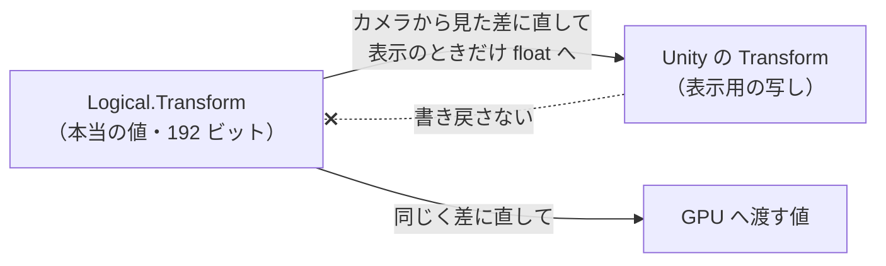

# Logical（正確な住所録）

**結論**：Omni では、物の位置と向きの「本当の値」を **Logical** という専用の数で持ちます。
Unity の `Transform` は、その本当の値から作った**表示用の写し**です。

## たとえ：住所録と地図アプリ

- **Logical** は、役所にある正確な住所録です。番地まで正確に書いてあり、勝手に丸められません。
- **Unity の `Transform`** は、スマホの地図アプリに表示されたピンです。
  画面に出すには十分ですが、拡大すると少しずれていることがあります。

ピンがずれていても、住所録が正しければ、いつでも正しい場所に置き直せます。
逆に、ピンの位置を住所録に書き戻すと、ずれが本当の値になってしまいます。
そのため Omni では、**写しから本当の値へは書き戻さない**決まりになっています。

## 数の形：192 ビットの固定小数点

Logical の 1 つの数（`Scalar`）は、**192 ビットの固定小数点**です。
固定小数点とは「小数点の位置が決まっている数」のことです。

<figure class="caption">
<svg class="fig" viewBox="0 0 720 200" width="720" role="img" aria-label="Scalar の 192 ビットの内訳">
  <rect x="40" y="50" width="24" height="60" class="c" stroke-width="2"/>
  <rect x="64" y="50" width="316" height="60" class="a" stroke-width="2"/>
  <rect x="380" y="50" width="300" height="60" class="b" stroke-width="2"/>
  <text x="52" y="86" text-anchor="middle" font-size="13">符号</text>
  <text x="222" y="86" text-anchor="middle" font-size="16">整数部 95 ビット</text>
  <text x="530" y="86" text-anchor="middle" font-size="16">小数部 96 ビット</text>
  <line x1="380" y1="36" x2="380" y2="124" class="sc" stroke-width="3"/>
  <text x="380" y="28" text-anchor="middle" font-size="13">小数点（ここで固定）</text>
  <text x="222" y="150" text-anchor="middle" font-size="14">最大およそ ±3.96×10²⁸ m</text>
  <text x="222" y="172" text-anchor="middle" font-size="12" class="muted">観測できる宇宙の半径（約 4.4×10²⁶ m）より大きい</text>
  <text x="530" y="150" text-anchor="middle" font-size="14">最小の目盛り 2⁻⁹⁶ m ≒ 1.26×10⁻²⁹ m</text>
  <text x="530" y="172" text-anchor="middle" font-size="12" class="muted">陽子の大きさ（約 10⁻¹⁵ m）よりずっと細かい</text>
</svg>
<figcaption>Scalar の中身（Q95.96 形式）。小数点の位置が動かないので、原点から遠くても目盛りの細かさは同じです。</figcaption>
</figure>

`float` との大きな違いは、**原点からの距離で細かさが変わらない**ことです。
宇宙の端でも、原点のすぐ横でも、目盛りは同じ 1.26×10⁻²⁹ m です。

| 型 | 役割 | 形 |
|---|---|---|
| `Scalar` | 長さ・座標の 1 成分 | 192 ビット（Q95.96） |
| `Position3` | 位置（X, Y, Z） | `Scalar` が 3 つ |
| `Quaternion` | 向き（回転） | 回転専用の 128 ビットの数（`RotationScalar`、Q1.126）が 4 つ |
| `Vector3` | 方向や差 | `Scalar` が 3 つ |

これらは `Assets/Omni/Core/Runtime/Logical/` にあります。

## 部品：Logical Transform

Scene の GameObject に付ける部品は **Logical Transform**（クラス名 `Omni.Logical.Transform`）です。
メニューの `Omni/Logical Transform` から付けられます。

| 項目 | 内容 |
|---|---|
| 持つもの | 位置・回転・大きさの本当の値。親子関係もこの値で合成します |
| Inspector の位置・大きさの欄 | 10 進の数か、`1.496e11` のような科学表記を入れられます。式は入れられません |
| 保存の形 | Scene ファイルには、192 ビットの中身をそのまま並べた文字列で保存されます。人が読む形ではありません |
| Unity の `Transform` との関係 | 表示用の写しを Logical Transform が書き込みます。`Transform` を直接動かしても本当の値は変わりません |

### 安全域：1 万 m

Unity の `Transform` に「本当の値に近い数」をそのまま入れてよいのは、
原点から ±10,000 m の内側だけです（`PhysicalSafety.Limit`）。
これを**安全域**と呼びます。

- 安全域の内側：Unity の `Transform` にも、ほぼそのままの位置が入ります。
  Unity の普通の機能（当たり判定、ライトの焼き込みなど）が素直に使えます。
- 安全域の外側：`Transform` は「描画に都合のよい代わりの値」になります。
  本当の位置は Logical Transform だけが知っています。

!!! warning "つまずきやすい点"
    - スクリプトから `transform.position` を書き換えても、Logical の本当の値は変わりません。
      位置を動かすときは Logical Transform の値を変えます。
    - 物理（Rigidbody や Collider）は Unity のまま `float` で動きます。
      遠くで物理を使う仕組みは、今の Omni にはありません。

## なぜ「早く `float` にしない」のか

計算の途中で一度 `float` にすると、そこで細かさが失われ、二度と戻りません。
Omni は次の順番を守ります。

1. Logical のまま、カメラとの**差**を求める（例：地球の表面とカメラの差は数 m）。
2. 差は小さいので、ここで初めて `float` にしても細かさが残る。
3. その `float` を Unity や GPU に渡す。

この「差を先に取る」考え方が、Omni 全体の基本です。
