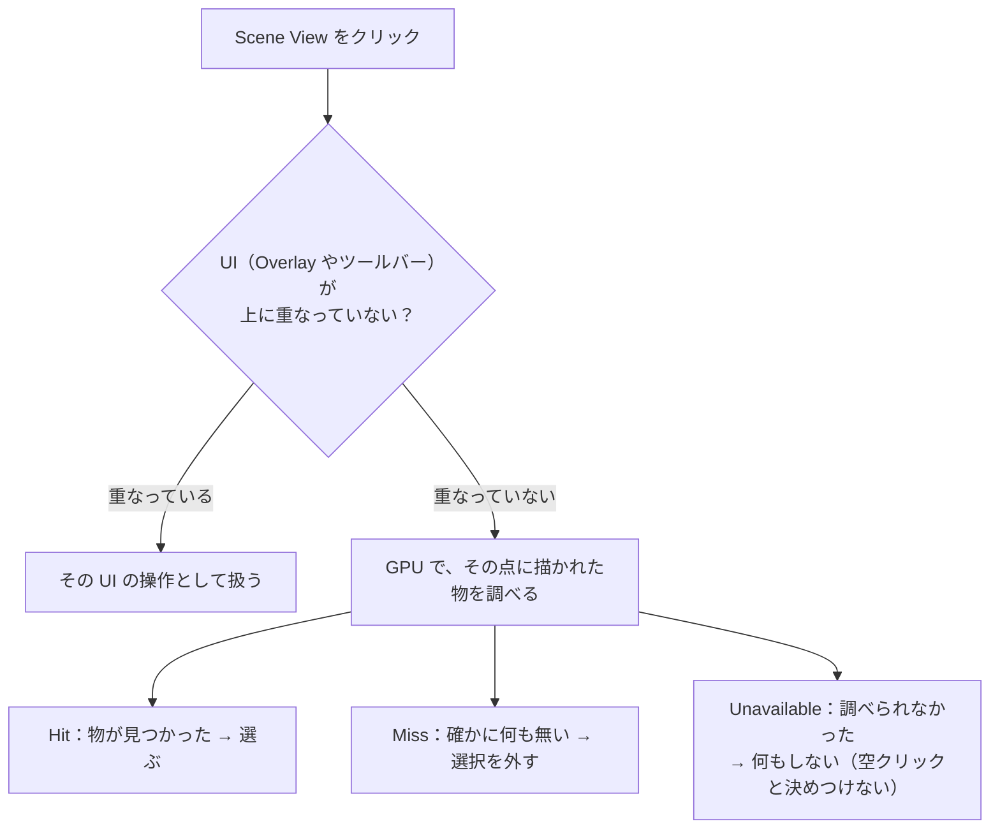

# クリックで選ぶ（Picking）

**結論**：Scene View で物をクリックして選ぶ仕組みを **Picking** と呼びます。
Omni では結果を 3 つに分けます。**当たった（Hit）**、**外れた（Miss）**、**分からない（Unavailable）** です。

## 困りごと：Unity の標準の選び方では当たらない

Unity の Scene View は、物の `Transform` の位置で「どこをクリックしたか」を判断します。
ところが Radial では、画面に見えている位置（縮めた位置）と `Transform` の位置が違います。
そのため、見えている物をクリックしても、標準の仕組みでは選べないことがあります。

## Omni の直し方：GPU に聞く

Omni は、**画面に実際に描いた絵**を使って、クリックした点に何が描かれているかを調べます。
描いた結果を調べるので、縮めた位置でも正しく選べます。

## なぜ「分からない」を分けるのか

「調べられなかった」を「何も無かった」と同じに扱うと、
物をクリックしたのに選択が外れる、という困った動きになります。
Omni は、確かめられなかったことを、成功にも失敗にも混ぜません。
この考え方は、Picking だけでなく、検証の結果（合格・不合格・確かめられない）にも共通しています。

!!! note "文書と実装の名前の違い"
    「Hit / Miss / Unavailable」は文書上の約束の名前です。
    実装（`OmniSelfCenteredRadialGpuPicker`）の中では、`Hit`、`Miss`、`NotReady`、`RenderError` という名前で状態を持っています。
    `NotReady` と `RenderError` が、文書でいう Unavailable にあたります。

## その他の Scene View の工夫

- マウスを乗せた物の輪郭を、GPU で描いて強調する。
- マウスの中ボタンで、クリックした地面の点を中心に回る。
- 選んだ物を、Radial の切り替えをまたいでも選んだままにする（`EntitySelectionProxy`）。

これらは Editor（`Assets/Omni/Core/Editor/`）の機能で、ゲームを実行したとき（Player）には入りません。
