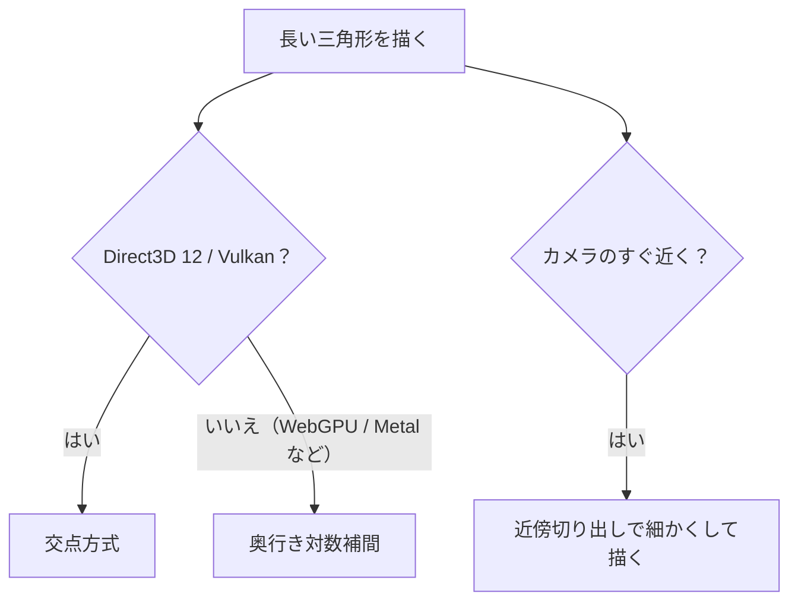

# Radial（遠くほど縮む物差し）

**結論**：Radial は、カメラからの距離を**対数**で縮めて描く仕組みです。
近くはほぼ距離に比例し、遠くはどんどん詰めます。
これで、目の前の小石から宇宙の端までを、1 台のカメラ・1 枚の奥行きにおさめます。

## たとえ：遠近法を強くした地図

駅の路線図を思い出してください。
都心の駅の間は広く描き、郊外の駅の間はぎゅっと詰めて描きます。
それでも駅の**順番**は正しく、1 枚の紙に全部おさまります。

Radial も同じです。

- **方向**はそのまま（カメラから見た向きは変えない）。
- **距離だけ**を縮める。遠いほど強く縮める。
- 順番（どちらが手前か）は崩さない。

<figure class="caption">
<svg class="fig" viewBox="0 0 720 220" width="720" role="img" aria-label="方向は変えず、距離だけ縮める">
  <circle cx="80" cy="110" r="10" class="fa"/>
  <text x="80" y="145" text-anchor="middle" font-size="13">カメラ</text>
  <line x1="90" y1="110" x2="700" y2="110" class="ln" stroke-dasharray="4 4"/>
  <text x="400" y="30" text-anchor="middle" font-size="14">本当の距離</text>
  <g font-size="12" text-anchor="middle">
    <circle cx="150" cy="60" r="6" class="fb"/><text x="150" y="48">1 m</text>
    <circle cx="300" cy="60" r="6" class="fb"/><text x="300" y="48">1 km</text>
    <circle cx="690" cy="60" r="6" class="fb"/><text x="690" y="48">遠い星</text>
  </g>
  <text x="400" y="200" text-anchor="middle" font-size="14">Radial で描く距離</text>
  <g font-size="12" text-anchor="middle">
    <circle cx="150" cy="170" r="6" class="fc"/><text x="150" y="188">1 m</text>
    <circle cx="240" cy="170" r="6" class="fc"/><text x="240" y="188">1 km</text>
    <circle cx="330" cy="170" r="6" class="fc"/><text x="330" y="188">遠い星</text>
  </g>
  <g class="ln" stroke-width="1.5">
    <line x1="150" y1="66" x2="150" y2="164"/>
    <line x1="300" y1="66" x2="240" y2="164"/>
    <line x1="690" y1="66" x2="330" y2="164"/>
  </g>
</svg>
<figcaption>上が本当の距離、下が Radial で描く距離。遠い物ほど強く手前に寄せますが、並ぶ順番は同じです。</figcaption>
</figure>

## 式とグラフ

使う曲線は 1 つだけです（`RadialSettings` に書かれています）。

\[
F(d) = S \cdot \log_2\!\left(1 + \frac{d \cdot M}{S}\right),\qquad S = 1
\]

| 記号 | 意味 |
|---|---|
| \(d\) | カメラからの本当の距離（Logical の値） |
| \(F(d)\) | 描くときの距離 |
| \(M\) | **View Scale**（どれだけ拡大して見るか）。`Camera の Near ÷ RadialCamera の nearClip` |
| \(S\) | 定数 1。設定はありません |

<figure class="caption">
<svg class="fig" viewBox="0 0 720 300" width="720" role="img" aria-label="F(d) のグラフ">
  <line x1="60" y1="260" x2="680" y2="260" class="ink" stroke-width="1.5"/>
  <line x1="60" y1="260" x2="60" y2="40" class="ink" stroke-width="1.5"/>
  <g font-size="12" text-anchor="middle">
    <text x="60" y="278">0</text><text x="210" y="278">5</text><text x="360" y="278">10</text>
    <text x="510" y="278">15</text><text x="660" y="278">20</text>
  </g>
  <text x="370" y="296" text-anchor="middle" font-size="13">本当の距離 d（M = 1 のとき）</text>
  <g font-size="12" text-anchor="end">
    <text x="52" y="264">0</text><text x="52" y="198">2</text><text x="52" y="132">4</text><text x="52" y="66">6</text>
  </g>
  <line x1="60" y1="260" x2="240" y2="62" class="sc" stroke-width="2" stroke-dasharray="6 4"/>
  <text x="250" y="70" font-size="13">そのまま描くと（F = d）</text>
  <polyline points="60,260 90,227 120,207.7 150,194 210,174.7 270,161 360,145.9 510,128 660,115" class="sa" stroke-width="3"/>
  <text x="520" y="110" font-size="13">Radial（F = log₂(1+d)）</text>
</svg>
<figcaption>M = 1 のときの F(d)。距離 20 を描いても 4.4 にしかなりません。距離 10²⁶ m（宇宙の大きさ）でも F は約 86 です。</figcaption>
</figure>

### View Scale M の役割

M は「どの距離から縮め始めるか」を決めます。曲がり始めは、本当の距離でおよそ \(1/M\) です。

| 例（数値は説明用） | Camera の Near | RadialCamera の `nearClip` | M | 曲がり始め |
|---|---|---|---|---|
| 地面を歩く | 0.1 | 0.01 m | 10 | 約 0.1 m |
| 100 nm の物を見る | 0.1 | 1×10⁻⁸ m | 10⁷ | 約 10⁻⁷ m |

ふつうの方法で 100 nm の物を見ようと Near を下げると、Far ÷ Near が約 30 億になり、奥行きが壊れます。
Radial なら Near は 0.1 のまま、Far ÷ Near はおよそ 2,800 におさまります（`RadialCamera` の説明より）。

## 部品：RadialCamera

カメラに付ける部品です。中身は「写像の設定を持つ入れ物」で、実際の描き換えは
`RadialGlobalRenderSystem` が、カメラが描く直前に行います。

| 項目 | 意味 |
|---|---|
| `nearClip` | 論理の Near。「カメラの Near 面が、本当は何 m を表すか」。Camera の Near は書き換えません |
| `farClip` | 論理の Far。これより遠い物は描きません |
| Center Under-clip（表示のみ） | 画面の中央では、Near より少し手前まで描かれる量。安全側に倒すために起きます |

関連する部品：

- `RadialCameraToggle`：ふつうの描画と Radial を切り替えます。
- Omni Manager の「対数レンダリング」ボタン：プロジェクト全体を Radial に切り替えます。

!!! warning "つまずきやすい点"
    - カメラに付けた `RadialCamera` は「Scene の変更」なので、保存せずに開き直すと消えます。
      Omni Manager の「RadialCameraを自動で付ける」が入っていれば、Scene を開いたときや Play のときに自動で付きます。
      残したいときは手で付けて保存します。
    - デモは「ふつうの描画」の状態で配られます。開いて何も映らないときは、
      Omni Manager で「対数レンダリング」を選んでください。

## 奥行きの 4 つの方式

Radial にすると、新しい問題が 1 つ出てきます。**とても長い三角形**です。

GPU は三角形の 3 つの角（頂点）だけを変換し、間は直線でつなぎます（補間）。
ところが Radial の変換は曲線なので、角だけ縮めて間を直線でつなぐと、
本当の面からずれてしまいます。地面のような大きな三角形ほどずれが大きくなります。

<figure class="caption">
<svg class="fig" viewBox="0 0 720 230" width="720" role="img" aria-label="長い三角形で、角だけ変換すると面がずれる">
  <circle cx="60" cy="190" r="9" class="fa"/>
  <text x="60" y="220" text-anchor="middle" font-size="12">カメラ</text>
  <path d="M 120 60 Q 360 200 660 60" class="sb" stroke-width="3"/>
  <text x="700" y="140" text-anchor="end" font-size="13">本当の面を縮めた形（曲がる）</text>
  <line x1="120" y1="60" x2="660" y2="60" class="sc" stroke-width="3" stroke-dasharray="7 5"/>
  <text x="390" y="48" text-anchor="middle" font-size="13">角だけ縮めて直線でつないだ形</text>
  <circle cx="120" cy="60" r="7" class="fc"/><circle cx="660" cy="60" r="7" class="fc"/>
  <text x="120" y="88" text-anchor="middle" font-size="12">頂点</text>
  <text x="660" y="88" text-anchor="middle" font-size="12">頂点</text>
  <line x1="390" y1="64" x2="390" y2="126" class="ink" stroke-width="1.5"/>
  <text x="400" y="100" font-size="13">ここがずれる</text>
</svg>
<figcaption>頂点だけ変換すると、間の面が本当の位置からずれます。手前の物にめり込んだり、欠けたりする原因です。</figcaption>
</figure>

これを解くために、Omni には 4 つの方式があります。呼び名は次の 4 つに決まっています。

| 方式 | やり方（ひとことで） | 使われる場面 |
|---|---|---|
| **奥行き線形補間** | 頂点で変換した奥行きを、GPU がそのまま直線でつなぐ。最初の方式 | 製品では使わない。検証用の Scene で比べるためだけに残っている |
| **奥行き対数補間** | 画面の点ごとに対数の奥行きを計算し直して書く | 交点方式が使えない環境（WebGPU、Metal など）の代わり |
| **交点方式** | 画面の点ごとに「視線と面がぶつかる点」を求め、そこから奥行きや照明の位置を作る。三角形の長さに左右されない | Direct3D 12 と Vulkan |
| **近傍切り出し** | カメラの近くにある長い三角形を、CPU が細かく切り出して小さな Mesh にして描く（`OmniNearPatch`） | すべての環境で、長い三角形の補助として |

!!! note "限界"
    交点方式でも、極端に長い柱（長さ 10²⁴ m 以上）などでは崩れることが、検証用の Scene で確かめられています。
    詳しくは [限界と対応環境](../outlook/limits.md) を見てください。

## Radial を切ったときとの関係

Omni は「いつでもふつうの描画に戻せる」ことを大切にしています。
Radial を切ると、同じ Scene が Unity の標準のやり方で描かれます。
両方で同じ物が同じ順番で見えることが、正しさの確認になります（どちらか片方だけ正しく見えても合格にしません）。
