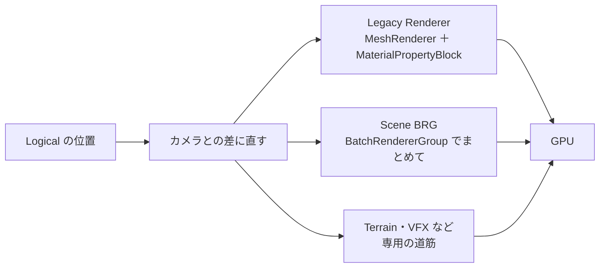
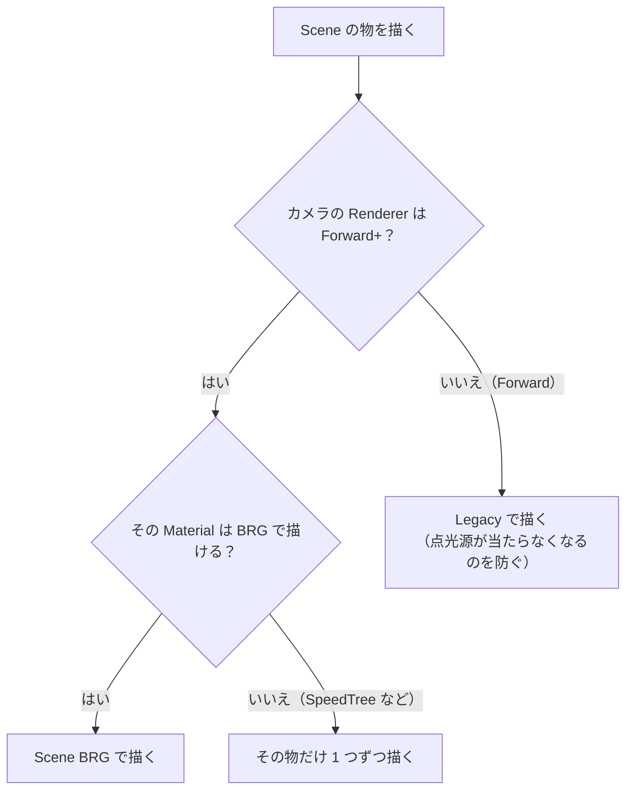

# 描く道筋（Renderer と BRG）

**結論**：Omni は、物を GPU に描かせる道筋を 2 つ持っています。
1 つずつ描く **Legacy（ふつうの Renderer）** と、まとめて描く **Scene BRG** です。
どちらで描いても、同じ位置に同じ物が見えなければなりません。

## たとえ：宅配便の出し方

- **Legacy Renderer**：荷物を 1 個ずつ窓口に持っていく。融通は利くが、数が多いと時間がかかる。
- **Scene BRG**：同じ種類の荷物をまとめて台車に載せ、一度に渡す。速いが、台車に載らない荷物もある。

## 2 つの道筋の比べ

| | Legacy Renderer | Scene BRG |
|---|---|---|
| 仕組み | Unity の `MeshRenderer` に、カメラごとの値（`MaterialPropertyBlock`）を渡して描く | Unity の `BatchRendererGroup`（BRG）に物をまとめて登録し、GPU 側で一度に描く |
| 速さ | 物が多いと遅くなる | 多くても速い |
| 点光源・スポットライト | どの Renderer 設定でも当たる | URP の **Forward+** でだけ当たる（Unity 標準の BRG も同じ） |
| 載らないもの | ほぼ無い | SpeedTree など、BRG が拒否する Material |
| Material の変更 | すぐ反映 | 複製（BRG 用 Material）を作って描くので、作り直しが要ることがある |

**BRG**（BatchRendererGroup）は Unity の機能で、たくさんの物を少ない命令でまとめて描くための仕組みです。
Omni はこれを使って、Scene の物を一括で描きます（Scene BRG）。

## 自動で道筋を切り替える

Omni は、正しく描けない道筋を使いません。

## カメラごとに分けて持つ

Scene BRG の状態は、**カメラの部品（Camera コンポーネント）ごと**に分けて持ちます。
GameObject ごとではありません。
Scene View と Game View のように、同じ物を違うカメラで見るときに、値が混ざらないようにするためです。

## Earth デモでの使われ方

Earth デモの岩と木（`EarthGroundScatter`）は、自分で作った Mesh を
`RadialBatchRendererRegistry.Register` で BRG に登録して描いています。
詳しくは [EarthGroundScatter](../demos/earth/scatter.md) を見てください。

!!! warning "つまずきやすい点"
    - Material の値を書き換えたのに見た目が変わらないときは、Omni Manager の「Scene BRG」タブで作り直します。
    - スクリプトで Material を差し替えたときは、`RadialSceneBatchRendererService.RequestRebuild()` を呼びます。
