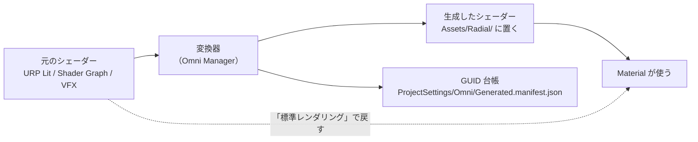

# シェーダーの変換

**結論**：Radial で描くには、シェーダーの中で「距離を縮める計算」をする必要があります。
Omni は、今あるシェーダー（URP の Lit、Shader Graph、VFX Graph など）を**自動で Radial 用に作り直します**。
元のシェーダーは残るので、いつでもふつうの描画へ戻せます。

## たとえ：翻訳版を別に作る

元の本（URP のシェーダー）には手を入れず、**翻訳版**（Radial 用のシェーダー）を別の棚に作ります。
「対数レンダリング」を選ぶと Material が翻訳版を読み、「標準レンダリング」を選ぶと元の本に戻ります。

## 変換の流れ

1. シェーダーの種類を見分ける（ShaderLab か Shader Graph か）。
2. 中身（SubShader、Pass、読み込むファイル、プロパティ）を調べる。
3. HLSL（シェーダーの言語）を書き換えて、Radial の計算（`RadialInject`）を差し込む。
4. 出来たものを検査する。
5. Material に当てはめる。

操作は Omni Manager の「Shaders」タブから行います。
最初の切り替えには時間がかかります（開発文書では約 112 秒の例があります）。

## 置き場所と台帳

| もの | 場所 | 消してよいか |
|---|---|---|
| 生成したシェーダー・Material の対応表など | `Assets/Radial/` | 消しても作り直せる（Git に入れない） |
| **GUID 台帳** | `ProjectSettings/Omni/Generated.manifest.json` | **消さない**。Git に入れる |

**GUID** は Unity がファイルを見分けるための背番号です。
台帳があれば、`Assets/Radial/` を消して作り直しても**同じ背番号**で復元できるので、
Scene や Material からの参照が切れません。

## 「保証済み」の意味

変換結果は 3 段階で判定されます。

| 判定 | 意味 |
|---|---|
| 保証済み | 決まった環境で、**同じ変換が毎回再現する**ことを確かめた |
| 検査のみ合格 | 検査には通ったが、保証の対象には入っていない |
| 変換不能 | 変換できない。黄色と黒の斜線に赤い X の「診断用」の見た目で描く |

!!! note "注意"
    「保証済み」は**見た目が正しいこと**の保証ではありません。変換が再現することの保証です。
    保証の表の対象は、2026 年 11 月時点で Unity 6000.6.8f1 の 1 つの環境だけです。

## 変換できないもの

- TextMesh Pro の SDF シェーダーなど、昔ながらの固定機能のシェーダー。
- 2D（Sprite）と Canvas の UI。
- 変換できないシェーダーを、似たシェーダーに**推測で置き換えることはしません**。間違った見た目を出さないためです。

## なぜ Unity の版に弱いのか

変換器は、URP のシェーダーの**文字**を探して書き換えています。
Unity や URP の版が上がってシェーダーの文字が変わると、書き換える場所が見つからなくなります。
そのときは変換を止めます（Fail Closed）。
これが Omni の一番大きな弱点で、開発文書でも「最大のリスク」とされています。

## 自分でシェーダーを書くとき

自作のシェーダーを Radial に対応させる手順は、Omni に同梱の
`CustomShaderGuide.md`（自作 Shader を対数描画に対応させるガイド）にあります。
Radial 用の名前は `_RadialGlobal_*`、`OmniRadial*`、`OMNI_RADIAL_*` で始まります。

Earth デモのシェーダー（`EarthTerrain.shader` など）は、最初から Radial を前提に書かれた専用のシェーダーです。
変換器で作るのではなく、Radial の計算を入れたファイル `RadialInject.hlsl` を自分で読み込んでいます。
