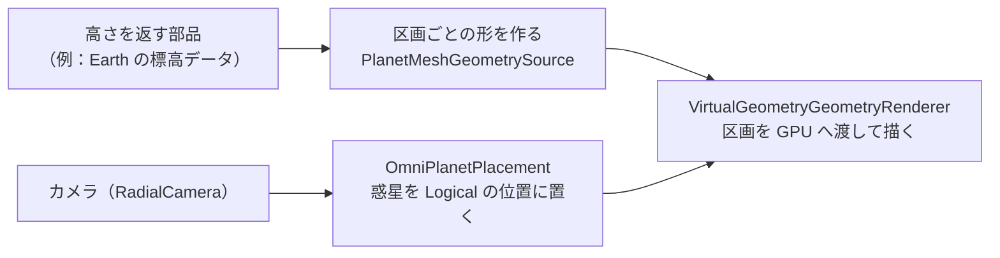
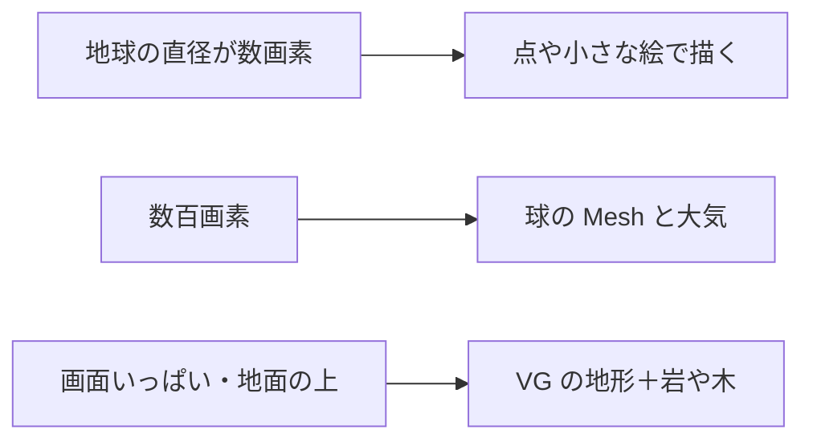

# VirtualGeometry（地形の描き方）

**結論**：**VirtualGeometry（VG）**は、形を「見える大きさに合わせた細かさ」で描く仕組みです。
近くは細かく、遠くは粗く描くので、惑星まるごとのような巨大な地形でも描けます。
Earth デモの地表も VG で描いています。

## たとえ：地図アプリのズーム

地図アプリは、日本全体を見ているときは県の形だけを、拡大すると道や建物を読み込みます。
画面に映る範囲と大きさに合わせて、必要な細かさだけを用意しているからです。
VG も同じで、画面上で 1〜2 画素の誤差に収まる細かさだけを選んで描きます。

<figure class="caption">
<svg class="fig" viewBox="0 0 720 300" width="720" role="img" aria-label="カメラの近くは細かい区画、遠くは粗い区画">
  <rect x="140" y="20" width="560" height="260" class="b" stroke-width="2"/>
  <g class="ln" stroke-width="1.2">
    <line x1="420" y1="20" x2="420" y2="280"/>
    <line x1="140" y1="150" x2="700" y2="150"/>
    <line x1="280" y1="150" x2="280" y2="280"/>
    <line x1="140" y1="215" x2="420" y2="215"/>
    <line x1="210" y1="215" x2="210" y2="280"/>
    <line x1="140" y1="247" x2="280" y2="247"/>
    <line x1="175" y1="247" x2="175" y2="280"/>
    <line x1="140" y1="263" x2="210" y2="263"/>
    <line x1="157" y1="263" x2="157" y2="280"/>
  </g>
  <circle cx="148" cy="272" r="8" class="fa"/>
  <text x="60" y="276" text-anchor="middle" font-size="13">カメラ</text>
  <line x1="75" y1="272" x2="138" y2="272" class="ink" stroke-width="1.5"/>
  <text x="560" y="90" text-anchor="middle" font-size="14">遠く：大きな区画で粗く</text>
  <text x="300" y="190" text-anchor="middle" font-size="13">中くらい</text>
  <text x="235" y="240" text-anchor="middle" font-size="12">近く</text>
</svg>
<figcaption>地面を区画（Cell）に分け、カメラに近い区画ほど 4 つに割って細かくします（四分木）。</figcaption>
</figure>

## 入口は 2 つ

| 入口 | 使い方 | 使う場面 |
|---|---|---|
| ① 用意したモデル | モデルの Import 設定で「Virtual Geometry」にチェックを入れるだけ | 高い精度で作った岩・像など |
| ② 実行時に作る地形 | 惑星（球）や平面を区画に分け、実行中に形を計算して作る | 惑星・月・大地。**Earth はこちら** |

<figure class="caption">

<figcaption>① の見本。起伏のある 30 万三角形の球を VG で描いた画面（Omni の開発文書より）。</figcaption>
</figure>

## 惑星の地形の作り方（② の場合）

惑星は「立方体をふくらませた球」（cube-sphere）として扱います。
立方体の 6 つの面をそれぞれ四分木で細かく割り、各区画（Cell）の高さを計算して Mesh にします。

## Omni 本体の 2 つの部品

Earth.unity の `Earth` オブジェクトに付いている次の 2 つは、デモ専用ではなく **Omni 本体の部品**です。

### OmniPlanetPlacement

| | |
|---|---|
| 場所 | `Assets/Omni/Core/VirtualGeometry/Runtime/Omni/OmniPlanetPlacement.cs` |
| 何のため | VG の惑星を、Omni の Logical の位置に置き、Radial で描けるようにする |
| すること | 毎フレーム、カメラと惑星の Logical の差を求め、見える範囲の判定と、区画ごとの Radial の値を用意する |
| Inspector の項目 | 無い（同じ GameObject の Logical Transform を使う） |
| いつ動くか | Edit Mode でも動く（`[ExecuteAlways]`）。Scene View でも Radial で描ける |

### VirtualGeometryGeometryRenderer

| | |
|---|---|
| 場所 | `Assets/Omni/Core/VirtualGeometry/Runtime/Mesh/Rendering/VirtualGeometryGeometryRenderer.cs` |
| 何のため | 実行時に作った区画の Mesh を、VG の「読み込み・選別・描画」の流れにつなぐ |
| すること | 区画の置き場（pool）を毎フレーム整理し、描く区画を集める |
| Inspector の項目 | 無い。別の部品が `Configure(...)` を呼んで設定する（Earth では `EarthSurfaceSetup`） |
| いつ動くか | Edit Mode でも動く。`Configure` されるまでは何もしない |

!!! tip "Inspector に何も出ない部品"
    この 2 つは、Inspector に設定欄がありません。
    同じ GameObject に付いている別の部品（Earth なら `EarthSurfaceSetup`）が、コードから設定します。
    「何も設定できない部品が付いている」のは、そういう分担だからです。

## VO（Virtual Object）

**VO** は、VG の上に乗る層で、「画面上で何画素の大きさに見えるか」によって**描き方そのもの**を変えます。
次の図は考え方の例です。

Earth デモは「地表・大気・雲・岩」を別々の VO として重ねる設計です（開発文書 `EarthDesign.md` より）。

## 動く条件

- Windows の **Direct3D 12** と **WebGPU**。
- URP の **Forward / Forward+**、MSAA なし。
- 使う URP の Renderer に **Virtual Geometry の Renderer Feature** が必要。
- 条件を満たさないときは描かずに止まり、理由を残します（Console には出ません）。

!!! note "まだ育っている機能"
    VG は 2026 年 11 月に Omni 0.1 の正式機能になりましたが、名前空間や型の名前は今後変わることがあります。
    コードの名前空間は、移植元の名前（`VirtualizedGeometry`、`VirtualGeometry.Omni` など）のままです。
