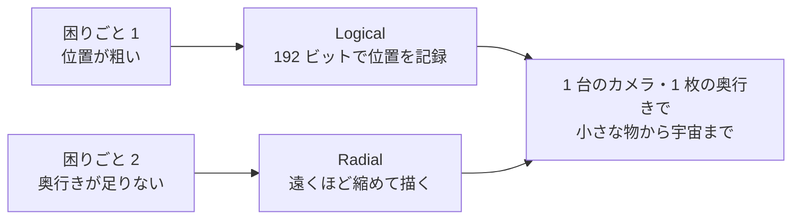

# なぜ必要か

**結論**：Unity は位置を `float`（有効数字およそ 7 桁）で持つため、原点から遠くなるほど位置が粗くなります。
さらに奥行きの記録にも限りがあるため、近くと遠くを同時に描くと前後がおかしくなります。
Omni はこの 2 つを別々の方法で解決します。

## 困りごと 1：遠くへ行くと物が震える

<figure class="caption">

<figcaption>原点に置いた小さな庭（Unity の標準のまま）。</figcaption>
</figure>
<figure class="caption">

<figcaption>同じ庭を約 640 万 m 離れた場所に置いたもの。位置が 0.5 m 刻みでしか表せず、形が崩れる。</figcaption>
</figure>

Unity の `Transform.position` は `float` です。
`float` は「だいたい 7 桁」までしか正確に覚えられません。
桁が大きくなるほど、小数点以下に使える桁が減ります。

たとえば、レジの電卓の表示が 8 桁しかないと考えてください。

- `1.2345678` なら、小数第 7 位まで表せます。
- `12345678` なら、小数点以下はもう表せません。

位置も同じです。原点から離れるほど、**表せる目盛りの間隔**が広がります。

<figure class="caption">
<svg class="fig" viewBox="0 0 720 300" width="720" role="img" aria-label="原点からの距離と float の目盛りの間隔">
  <line x1="60" y1="250" x2="690" y2="250" class="ink" stroke-width="2"/>
  <line x1="60" y1="250" x2="60" y2="30" class="ink" stroke-width="2"/>
  <text x="375" y="290" text-anchor="middle" font-size="14">原点からの距離</text>
  <text x="24" y="140" text-anchor="middle" font-size="14" transform="rotate(-90 24 140)">目盛りの間隔</text>
  <g font-size="12" text-anchor="middle">
    <text x="120" y="268">10 m</text><text x="250" y="268">10 km</text>
    <text x="380" y="268">100 km</text><text x="510" y="268">1000 km</text><text x="640" y="268">太陽と地球</text>
  </g>
  <g class="fa">
    <rect x="105" y="246" width="30" height="4"/>
    <rect x="235" y="214" width="30" height="36"/>
    <rect x="365" y="196" width="30" height="54"/>
    <rect x="495" y="158" width="30" height="92"/>
    <rect x="625" y="50" width="30" height="200"/>
  </g>
  <g font-size="12" text-anchor="middle">
    <text x="120" y="238">約 0.001 mm</text>
    <text x="250" y="206">約 1 mm</text>
    <text x="380" y="188">約 8 mm</text>
    <text x="510" y="150">約 6 cm</text>
    <text x="640" y="42">約 16 km</text>
  </g>
</svg>
<figcaption>float で表せる位置の細かさ（おおよその値。縦は見やすさのため縮めています）。地球と太陽の距離では、16 km 単位でしか位置を表せません。</figcaption>
</figure>

その結果、次のようなことが起きます。

- キャラクターや車が、止まっているのにガタガタ震える。
- 影が少しずつずれる。
- 2 つの面が交互にちらつく。

Unity の開発者自身も、エンジン本体は倍精度（`double`）に対応しておらず、
世界の広さの目安は数十 km までだと説明しています（Omni の開発文書より）。

## 困りごと 2：奥行きの前後が入れ替わる

GPU は、画面の各点について「カメラからどれだけ遠いか」を**奥行きバッファ**（Z バッファ）に書きます。
奥行きバッファも数字の細かさに限りがあります。
そのため、カメラの **Near**（一番手前）と **Far**（一番奥）の比が大きいと、
遠くの物どうしの前後が区別できなくなります。

| やりたいこと | Near | Far | Far ÷ Near |
|---|---|---|---|
| ふつうのゲーム | 0.3 m | 1000 m | 約 3,000 |
| 目の前の 100 nm の物から遠くまで | 0.0000001 m | 300 m | 約 30 億（破綻） |

「目の前の小さな物」と「遠くの大きな物」を同時に描こうとすると、
奥行きの記録が足りなくなります。

## よくある回避策と、その弱点

| 回避策 | やり方 | 弱点 |
|---|---|---|
| 原点を動かす | プレイヤーが遠くへ行ったら、世界全体をずらして原点へ戻す | 震えは直るが、奥行きの問題は残る |
| カメラを重ねる | 遠景用と近景用のカメラを別々に描いて重ねる | 影や半透明がカメラの境目で切れる |
| 縮尺を変える | 遠くの物だけ小さく作って近くに置く | 実際の大きさ・距離の関係が崩れる |

## Omni の直し方

- 位置の正確さは [Logical](logical.md) で解決します。
- 奥行きの足りなさは [Radial](radial.md) で解決します。
