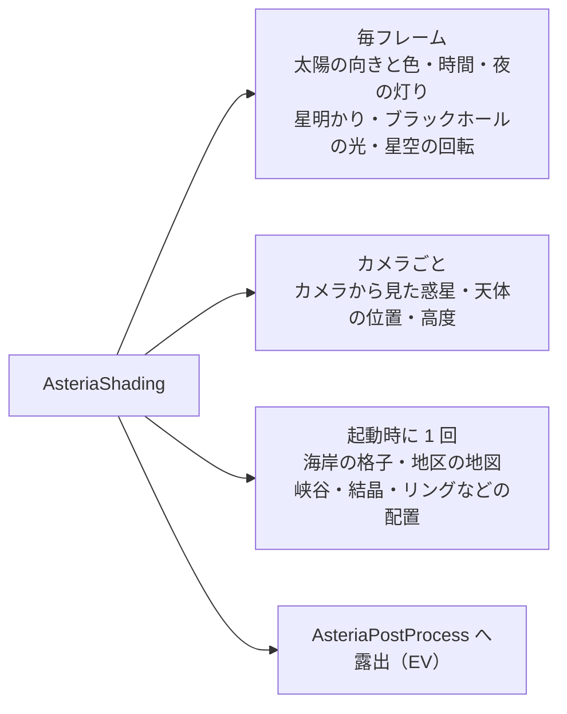
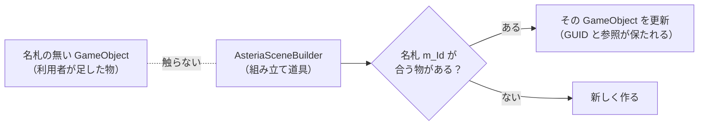

# 司令塔と照明

Asteria の「全体の決まり」を持つ部品たちです。
とくに `AsteriaShading` は、Asteria で**一番大事な部品**です。

## AsteriaShading（時計と照明の司令塔）

**一言で**：寸法表を読んで世界の規則を作り、時刻（太陽の位置）・ブラックホールの光・星空・目の順応（自動露出）を管理し、
その値を Asteria の**全シェーダー**へ配る部品です。

| | |
|---|---|
| 付いている所 | `LogicalWorld`（Scene の根） |
| ファイル | `Assets/Omni/Development/Asteria/Runtime/Core/AsteriaShading.cs` |
| いつ動くか | Edit Mode でも動く（`[ExecuteAlways]`）。毎フレームの `Update`、順応は `LateUpdate`、カメラが描く直前ごと |

### 配っている値

変数の名前はすべて `_Asteria` で始まります（例：`_AsteriaSunDirection`、`_AsteriaParams`、`_AsteriaCoastGrid`）。

### Inspector の項目

| 項目 | 意味 |
|---|---|
| `m_World` | 寸法表（`AsteriaWorld.json`） |
| `m_Planet` / `m_Moons` | 惑星と衛星の `Logical Transform` |
| `m_SubsolarLatLon` | 主星が真上に来る地点（緯度・経度）。**これが「時刻」の正体** |
| `m_NightLights` | 夜の街の灯りの強さ |
| `m_StarlightLux` | 星明かりの明るさ（既定 0.002 lx） |
| `m_Exposure` | 露出 |
| `m_CityAwake` | 灯りの消えた地区も点く割合（0〜1） |
| `m_BlackHole` | ブラックホールの設定（見える帯、仰角、光の強さなど） |
| `m_Adaptation` | 目の順応の設定（自動か、最大何段か、慣れる速さ） |

### 時刻の変え方

「主星が真上に来る地点」を動かすと、惑星のどこが昼でどこが夜かが変わります。
スクリプトからは `SetTimeOfDay(Day / Dusk / Night)`、`SetLocalTime`、`SetSubsolarPoint` などで変えます。

!!! warning "つまずきやすい点"
    - 毎フレーム時刻を少しずつ進めるときは、引数 `jump=false` を使います。`true` だと目の順応が一瞬で終わってしまいます。
    - ブラックホールの表は作るのに約 20 ms かかるので、1 フレーム 3 ms ずつ数フレームかけて作ります。できるまでブラックホールは描かれません。
    - 部品を無効にすると、配った値を 0 に戻します。他の Scene に値を残さないためです。
    - 結晶・海上リング・峡谷の弧は、それぞれ 4 つまでしか置けません（シェーダーの配列の長さ）。

## AsteriaPostProcess（明るさの後処理）

**一言で**：URP の Volume を使って、**夜の灯りのにじみ（Bloom）**と、**目の順応による明るさ（Post Exposure）**を調整する部品です。

| | |
|---|---|
| 付いている所 | `PostProcess`（URP の `Volume` と一緒。`[RequireComponent(typeof(Volume))]`） |
| ファイル | `Runtime/Core/AsteriaPostProcess.cs` |
| 値をくれる部品 | `AsteriaShading`（`SetExposure` を呼ぶ） |

- 共有のプロファイル資産は書き換えず、Play 中の複製だけを変えます。
- Edit Mode では見た目は変わりません。
- WebGPU では Bloom を軽くします。

### 目の順応とは

暗い所に入ると、最初は真っ暗でも、だんだん見えてきます。これが目の順応です。
Asteria では、日没や夜の街で画面が真っ黒にならないよう、明るさを数秒かけて上げます（最大 6 段）。

## AsteriaGeneratedRole（目印）

**一言で**：Scene の組み立て道具（`AsteriaSceneBuilder`）が「これは自分が作った物だ」と見分けるための**名札**です。

| | |
|---|---|
| 付いている所 | Asteria のすべての GameObject |
| ファイル | `Runtime/Core/AsteriaGeneratedRole.cs`（11 行） |
| 項目 | `m_Id`（役割の名前） |
| 動き | 何もしない（データだけ） |

組み立て直すたびに全部作り直すと、GameObject の ID が変わり、他からの参照が切れます。
名札で見分けて「あれば更新、なければ作成」にすることで、それを防いでいます。

!!! warning "つまずきやすい点"
    名札の無い GameObject が、名札付きの物と同じ名前で根に置かれていると、組み立て道具は例外を出して止まります。

## AsteriaAtmosphere（大気）

**一言で**：空の色、遠くのかすみ、惑星の縁の光、雲を、画面全体に描き足す部品です。
考え方は Earth の [EarthSkyRenderer](../earth/sky.md) と同じで、大気の表（LUT）を作って使います。

| | |
|---|---|
| 付いている所 | `Main Camera` |
| ファイル | `Runtime/Atmosphere/AsteriaAtmosphere.cs` |
| いつ動くか | Edit Mode でも動く（`[ExecuteAlways]`）。カメラが描く直前ごと |
| 主な項目 | `m_Shader`、`m_LutShader`、`m_Camera`、`m_Shading`、`m_Planet`、`m_GroundAlbedo`（地面の反射率 0.2）、`m_AnalyticGroundDistanceKm`（20）、`m_Clouds` |

- LUT は 5 種類（透過率・多重散乱・天空照度・空の見え方・ブラックホール向きの空の見え方）。
- `_AsteriaAtmLighting.x = 1` を置いて、「地表や建物の照明は LUT を使ってよい」と知らせます。
- 付いているカメラにだけ描きます。Scene View などほかのカメラでは合成しません。
- EarthToMoon デモのコードを複製したものです（デモどうしでコードを共有しない方針）。
