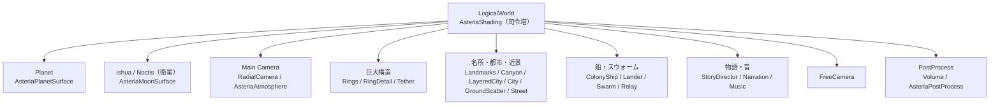
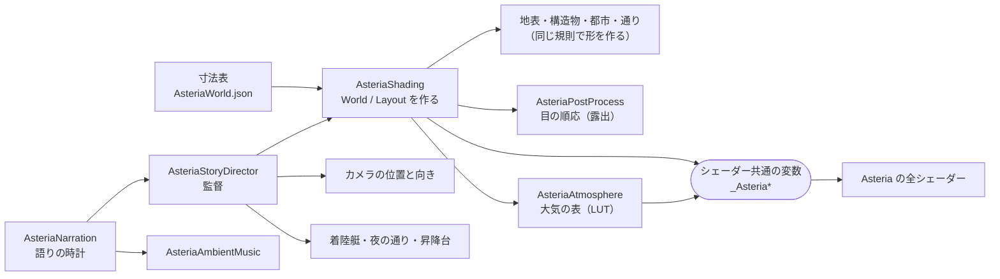

# Asteria（人工惑星）

**結論**：Asteria は、移民船が人工惑星「アステリア」に到着してから、地上の夜の街に降り立つまでを、
約 10 分半（639 秒）の物語として見せるデモです。
独自の部品は約 25 種類あり、Earth よりずっと多いです。
中心になるのは **`AsteriaShading`（時計と照明の司令塔）** と **`AsteriaStoryDirector`（監督）** の 2 つです。

!!! info "このデモの立場"
    - 場所は `Assets/Omni/Development/Asteria/`。**開発用**で、製品 0.1.0 には入れません。
    - Scene は `Asteria.unity` の 1 本だけ。`Editor/AsteriaSceneBuilder.cs` が組み立てます。
    - Earth とはコードを共有しません。必要な部品は、出典を書いて複製しています（例：大気は EarthToMoon デモの複製）。

## 物語のあらすじ

人工惑星アステリアのある恒星系に、移民船が長い旅の末に到着します。
主星（太陽）はさらに巨大なブラックホールの周りを回っていて、空には赤橙の円盤が見えます。
惑星の文明はすでに滅んでいますが、保守用の機械は誰もいないまま動き続けています。
声は 4 人（語り手・操縦士・最年少の乗員・船の AI）で、人物は画面に映さず、船内や無線の声として聞かせます。

| 章 | 時間（秒） | 見せるもの |
|---|---|---|
| A 到着 | 0〜194 | 船の遠景、集光板の群れ（スウォーム）、北極へのビーム、2 つの衛星の低空通過 |
| B 降下 | 194〜372 | 惑星の全景とリング、着陸艇の分離、大気圏への突入、都市の上空 |
| C 地上 | 372〜554 | 峡谷、峡谷の列車、中央の塔（スパイア）、発着台への着陸 |
| D 日没 | 554〜594 | 日没の空。594 秒でエンディングの暗転とタイトル |
| D2 夜の街 | 594〜639 | 昇降台で夜の通りへ降りる（台詞なし） |

物語が終わると、自由カメラで夜の通りを歩けるようになります。

## Scene の中身

Scene の根（一番上の親）は `LogicalWorld` 1 つだけで、ほかの約 23 個の GameObject はすべてその子です。
どの GameObject にも `Logical Transform` と `AsteriaGeneratedRole`（目印）が付いています。

## 部品の分類

| 分類 | 部品 | 説明のページ |
|---|---|---|
| 司令塔（時刻・照明・目の順応） | `AsteriaShading`、`AsteriaPostProcess`、`AsteriaGeneratedRole` | [司令塔と照明](core.md) |
| 大気 | `AsteriaAtmosphere` | [司令塔と照明](core.md) |
| 地表（VG） | `AsteriaPlanetSurface`、`AsteriaMoonSurface` | [惑星と衛星の地表](surface.md) |
| 巨大構造・名所・都市・近景 | `AsteriaRings`、`AsteriaRingDetail`、`AsteriaTether`、`AsteriaLandmarks`、`AsteriaCanyon`、`AsteriaLayeredCity`、`AsteriaCity`、`AsteriaGroundScatter`、`AsteriaStreet` | [構造物と都市](structures.md) |
| 船・スウォーム・中継 | `AsteriaColonyShip`、`AsteriaLander`、`AsteriaSwarm`、`AsteriaRelay` | [船と宇宙の構造物](ships.md) |
| 物語・音・カメラ・入口 | `AsteriaStoryDirector`、`AsteriaNarration`、`AsteriaAmbientMusic`、`AsteriaFreeCamera`、`AsteriaContentLoader`、`AsteriaWebEntry` ほか | [物語・音・カメラ](story.md) |

## データの流れ

Asteria の世界の寸法（惑星の大きさ、都市の位置、リングの数など）は、すべて 1 つの **寸法表**（`Data/AsteriaWorld.json`）に書かれています。
`AsteriaShading` がそれを読んで「配置の規則」を作り、ほかの部品はその規則を見て形を作ります。

- 「語りの時計」が物語の時間の基準です。監督（`AsteriaStoryDirector`）は、その時計を見てカメラを動かし、場面に合わせて時刻（昼・夕・夜）を切り替えます。
- 形はほぼすべて**実行中に計算で作ります**。Scene に保存されているのは、部品と設定だけです。

## 設計の大きな判断

| 判断 | 理由 |
|---|---|
| **影を作らない** | 惑星を実行中に手続きで作り、Radial で頂点を縮めるため。代わりに大気の透過、空からの光、にせの陰（擬似 AO）、映り込みで形を見せる |
| URP のライトを使わない | 主星の向きを `AsteriaShading` がシェーダー共通の変数で配り、各シェーダーが読む |
| URP Lit を使わない | Asteria 専用の、最初から Radial 用のシェーダーで描く |
| デモどうしでコードを共有しない | デモを別々に直せるようにするため |

## 進み具合（2026 年 11 月時点）

| 項目 | 状態 |
|---|---|
| 地表の VG 化、物語の通し、WebGPU での通し再生（27.4 MB） | できている |
| 夜の通りの自由歩行、昇降台、D2 | Edit Mode のテストまで。Player と Web では未実行 |
| 夜の通りの光の重さ | 目標（2.0 ms 以下）に届いていない |
| リングと都市の「近づくと実物の部材に替える」詳細 | 一部の範囲だけ試験中 |
| 音声の配信（Addressables） | 声だけ、Windows で確認済み |
