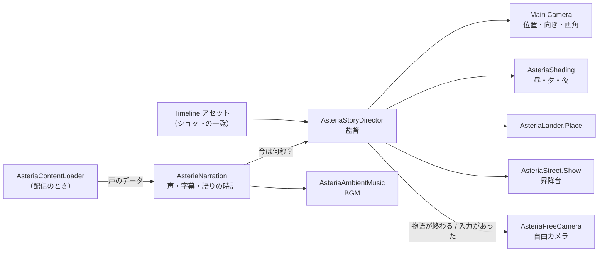

# 物語・音・カメラ

**結論**：Asteria の物語は、**語りの時計**（`AsteriaNarration`）を基準に、**監督**（`AsteriaStoryDirector`）がカメラと場面を動かして進みます。
物語の後は、**自由カメラ**（`AsteriaFreeCamera`）で歩き回れます。

## 全体の関係

## AsteriaStoryDirector（監督）

| | |
|---|---|
| 付いている所 | `StoryDirector` |
| ファイル | `Runtime/Narrative/AsteriaStoryDirector.cs` |
| いつ動くか | Play 中。`Awake` で Timeline を読み、`LateUpdate` で毎フレーム動かす |

**何をしているか**：

- Unity の **Timeline アセット**に並べた「ショット」（場面ごとのカメラの動き）を読みます。1 つのクリップが 1 つのショットです。
- 語りの時計の秒数を見て、今のショットのカメラの位置・向き・画角を決めます。
- ショットが替わるときに、時刻（昼・夕・夜）を `AsteriaShading` で切り替えます。
- 着陸艇を動かし、D2 では夜の通りを出して昇降台を動かします。
- 最後に暗転してタイトルを出します。

| 項目 | 意味 |
|---|---|
| `m_StoryTimeline` | ショットの正本（Timeline アセット） |
| `m_Narration` | 語りの時計を持つ部品 |
| `m_Shading` | 時刻を変える先 |
| `m_Ship`、`m_Swarm`、`m_Lander`、`m_Relay` | カメラが追いかける・動かす物 |
| `m_FreeCamera` | 物語の後や、入力があったときに替わる自由カメラ |
| `m_Viewer` | 動かすカメラ |

!!! warning "つまずきやすい点"
    - Timeline が無い、または壊れていると、物語を始めません（コードの中の予備の表には戻りません）。
    - 自由カメラの操作（キーやマウス）をすると、物語は止まります。
    - D2 で変えた物（夜の通り・昇降台・時刻）は、`RestoreStage()` で元に戻します。

## AsteriaNarration（声・字幕・語りの時計）

| | |
|---|---|
| 付いている所 | `Narration` |
| ファイル | `Runtime/Narrative/AsteriaNarration.cs` |
| 主な項目 | `m_Manifest`（台詞の表）、`m_Clips`（声の音声）、`m_Volume` |

- 声を再生し、字幕を出し、右上に音声の作成ソフトのクレジットを出します。
- **語りの時計**（`ClockSeconds`）を持っていて、物語全体の時間の基準になります。
- 字幕の言語は、Editor では Editor の言語、Player では OS の言語、Web では英語だけです。起動時の引数 `-asteria-lang ja|en` で変えられます。
- Play するまで何もしません。

## AsteriaAmbientMusic（BGM）

- 外部の曲は使わず、和音の音を**その場で合成**します（`AsteriaAmbientSynth`）。
- 章（A〜D）によって根音を変え、台詞の間は音を小さくし、物語の最後の 6 秒で消えていきます。
- 項目：`m_Narration`、`m_Story`、`m_Volume`（0.55）。

## AsteriaFreeCamera（自由カメラ）

| 操作 | 動き |
|---|---|
| W / S | 前・後ろ |
| D / A | 右・左 |
| E または Space / Q または 左 Ctrl | 上・下 |
| 左 Shift（押している間） | 速く動く |
| 右ボタンを押しながらマウス | 見回す |
| ホイール | 速さを変える |
| 1・2 | 名所の塔の空中通路へ |
| 3 | 夜の通りを歩く |

- 入力があったフレームだけカメラを動かします。物語が置いた位置から、そのまま操作を引き継げます。
- 中央都市区の外では、高さの下限（約 20 km）があります。
- 夜の通りが置かれていないと歩けません。理由は `LastWalkRefusal` に残ります。

## 入口と検証の部品（Scene には無い）

次の部品は Scene に保存されていません。起動したときに、条件が合えば自分で GameObject を作ります。

| 部品 | いつ働くか | 役割 |
|---|---|---|
| `AsteriaWebEntry` | WebGPU のビルドだけ | 「クリックかタップで始める」画面を出し、最初の操作で物語を始める。ブラウザは、利用者が操作するまで音を鳴らせないため |
| `AsteriaWebProbe` | URL に `?probe=1` | 近景の 1 フレームの時間を測る |
| `AsteriaContentLoader` | 配信モードのビルド | 声のデータを Addressables で読み込み、`AsteriaNarration` に渡す |
| `AsteriaPlayerSmoke` | 起動引数 `-asteria-smoke <フォルダ>` | Player の受け入れ確認用に自動で撮影し、結果を書き出して終わる |
