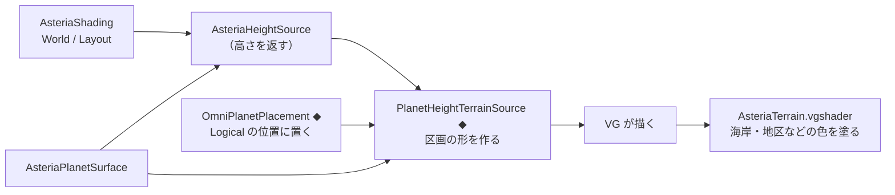

# 惑星と衛星の地表

**結論**：アステリアの地表と、2 つの衛星（イシュアとノクティス）の地表は、どちらも Omni 本体の **VirtualGeometry（VG）** で描いています。
Asteria の部品は「高さを返す仕組み」と「材質」を VG に渡す係です。

◆ = Omni 本体の部品（[VirtualGeometry](../../basics/virtual-geometry.md) を参照）

## AsteriaPlanetSurface（惑星の地表）

| | |
|---|---|
| 付いている所 | `Planet`（同じ所に `PlanetHeightTerrainSource` と `OmniPlanetPlacement`） |
| ファイル | `Runtime/Planet/AsteriaPlanetSurface.cs` |
| いつ動くか | Play 中だけ。`Start` で設定し、`Update` は警告の見張りだけ |

**何をしているか**：`AsteriaShading` から世界の規則をもらい、高さを返す仕組み `AsteriaHeightSource` を作って、
`PlanetHeightTerrainSource.Configure(...)` に渡します（区画の最も深い階層 24、目標 4 画素、区画を作る時間は 1 フレーム 4 ms まで）。

| 項目 | 意味 |
|---|---|
| `m_Material` | 地表の材質（`.vgshader`） |
| `m_Viewer` | カメラの `Logical Transform` |
| `m_Shading` | `AsteriaShading` |

`AsteriaHeightSource` は、描画と「地面に立つ高さ」の両方が使う**高さの正本**です。
裏のスレッドから同時に呼ばれても正しく動くように作られています。

## AsteriaMoonSurface（衛星の地表）

| | |
|---|---|
| 付いている所 | `Ishua`（氷の衛星）、`Noctis`（岩の衛星） |
| ファイル | `Runtime/Moons/AsteriaMoonSurface.cs` |
| 違い | 高さは `AsteriaMoonHeightSource`。項目 `m_Body` で何番目の天体かを指定し、材質の `_AsteriaBody` で見た目を切り替える |

衛星は「物語の基準の時刻」の位置に置かれます。物語の時間に合わせて衛星が動く処理は、まだありません。

!!! warning "つまずきやすい点（2 つの部品に共通）"
    - 同じ GameObject に `PlanetHeightTerrainSource` と `OmniPlanetPlacement` が無いと、エラーを出して止まります。
    - 使っている URP の Renderer に **Virtual Geometry の Renderer Feature** が無いと、区画が選ばれず何も描かれません。300 フレーム後に警告が出ます。
    - この部品が VG に設定するのは Play 中（`Start`）だけです。地表を見るときは Play します。

## Earth との違い

| | Earth | Asteria |
|---|---|---|
| 高さの元 | 実際の標高データ（GEBCO、アルプスの実データ） | 寸法表と規則から全部計算で作る（架空の惑星） |
| VG への渡し方 | `EarthSurfaceSetup` が `VirtualGeometryGeometryRenderer.Configure` を呼ぶ | `AsteriaPlanetSurface` が `PlanetHeightTerrainSource.Configure` を呼ぶ |
| Edit Mode | 地表を用意する | VG への設定は Play 中だけ |
| 影 | 岩は影なし（木だけにせの影） | 影を作らない設計 |
