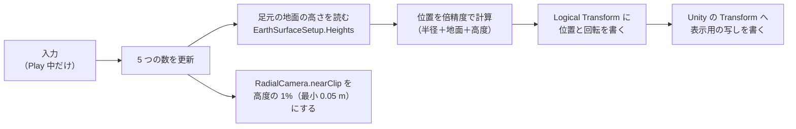

# EarthOrbitCamera（カメラ操作）

**一言で**：カメラの位置と向きを「緯度・経度・高さ・向き・見下ろす角度」の 5 つの数で持ち、
それを Logical の位置に直して書き込む部品です。マウスとキーで操作できます。

| | |
|---|---|
| 付いている所 | `Main Camera` |
| ファイル | `Assets/Omni/Development/Earth/Scene/EarthOrbitCamera.cs` |
| 名前空間 | `Omni.Earth.Demo`（アセンブリ `Omni.Earth.Demo`。**この Scene 専用**） |
| いつ動くか | Edit Mode でも動く（`[ExecuteAlways]`）。入力を読むのは Play 中だけ。Edit Mode では値を変えると動く |

## 5 つの数で姿勢を表す

<figure class="caption">
<svg class="fig" viewBox="0 0 720 300" width="720" role="img" aria-label="緯度・経度・高度・向き・俯角">
  <circle cx="190" cy="170" r="110" class="b" stroke-width="2"/>
  <ellipse cx="190" cy="170" rx="110" ry="30" class="ln" stroke-dasharray="4 4"/>
  <line x1="190" y1="60" x2="190" y2="280" class="ln" stroke-dasharray="4 4"/>
  <text x="190" y="52" text-anchor="middle" font-size="12">北極（+Y）</text>
  <line x1="190" y1="170" x2="265" y2="100" class="ink" stroke-width="1.5"/>
  <circle cx="265" cy="100" r="5" class="fc"/>
  <line x1="265" y1="100" x2="320" y2="50" class="sc" stroke-width="2.5"/>
  <circle cx="320" cy="50" r="8" class="fa"/>
  <text x="330" y="44" font-size="13">カメラ</text>
  <text x="305" y="88" font-size="12">高度</text>
  <text x="200" y="130" font-size="12">緯度・経度</text>
  <rect x="420" y="40" width="280" height="230" rx="12" class="a" stroke-width="2"/>
  <text x="440" y="72" font-size="14">緯度・経度 … 地球のどこの上か</text>
  <text x="440" y="104" font-size="14">高度 … 足元の地面からの高さ</text>
  <text x="440" y="136" font-size="14">向き … 0° が北、90° が東</text>
  <text x="440" y="168" font-size="14">俯角 … 0° が水平、−90° が真下</text>
  <text x="440" y="214" font-size="13" class="muted">地面の高さは高さの正本から読むので、</text>
  <text x="440" y="236" font-size="13" class="muted">山の上でも地面にもぐらない</text>
</svg>
<figcaption>カメラの姿勢は 5 つの数で決まります。位置は倍精度（double）で計算してから Logical に書きます。</figcaption>
</figure>

## 操作（Play 中）

| 操作 | 動き |
|---|---|
| 左ドラッグ | 地球の周りを回る（緯度・経度が変わる）。高いほど大きく動く |
| 右ドラッグ | 向きと俯角を変える（見回す） |
| ホイール | 高度を 1 目盛りで 15% 変える。宇宙から目の高さまで約 170 目盛り |
| 数字キー 1〜9 | 決まった場所へ飛ぶ（下の表） |

| キー | 場所 |
|---|---|
| 1 | 高度 2 万 km から真下を見る（地球全体） |
| 2・3 | 高度 400 km（真下と、斜め） |
| 4・5 | 高度 20 km・10 km（雲の上） |
| 6 | アルプスの上 10 km |
| 7 | アルプスの上 1 km |
| 8 | 森の上 100 m |
| 9 | 地面に立った目の高さ 1.7 m |

高度は 1.7 m（目の高さ）から 6 万 km までに制限されます。

## 毎フレームしていること

### なぜ nearClip を毎フレーム変えるのか

[Radial](../../basics/radial.md) のページで説明したとおり、`nearClip` は「どの距離から縮め始めるか」を決めます。
宇宙にいるときと地面に立っているときでは、見たい近さがまったく違います。
そこで「高度の 1%」にして、どの高さでも画面に対して同じくらいの近さになるようにしています。

## Inspector の項目

| 項目 | 意味 | Scene の初期値 |
|---|---|---|
| `latitudeDegrees` | 緯度 | 20 |
| `longitudeDegrees` | 経度 | 0 |
| `altitudeMeters` | 高度（m） | 20,000,000 |
| `headingDegrees` | 向き | 0 |
| `pitchDegrees` | 俯角 | −90（真下） |
| `radial` | 同じカメラの `RadialCamera` | |

## 一緒に使う部品

| 部品 | 関係 |
|---|---|
| `Logical Transform`（同じ GameObject） | 位置と回転を書き込む先 |
| `RadialCamera`（同じ GameObject） | `nearClip` を書き込む先 |
| `EarthSurfaceSetup` | 足元の地面の高さを借りる（Scene から自動で探す） |

!!! warning "つまずきやすい点"
    - Unity の `Transform` を直接動かしても、次のフレームでこの部品が上書きします。動かすときは Inspector の 5 つの数を変えます。
    - 地表の準備ができる前は、地面の高さを 0（海面）として置きます。
    - Game View でキーが効かないときは、Play しているか、Editor が前面にあるかを確かめてください（Unity の標準の動きです）。
