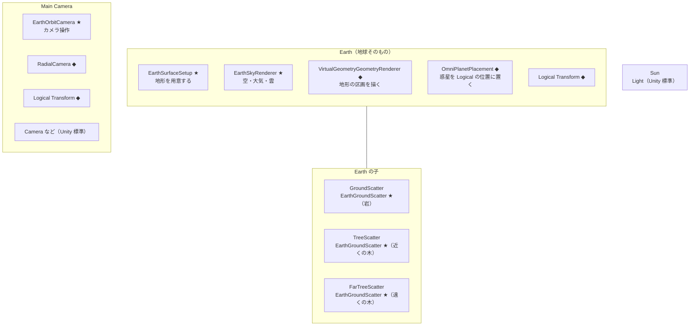
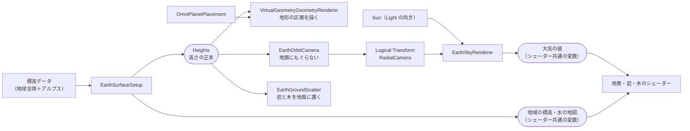

# Earth（地球）

**結論**：Earth デモは、宇宙から見た地球の全体から、地面に立った目の高さ（1.7 m）までを、切れ目なく見せるデモです。
`Earth.unity` に付いている独自の部品は **4 種類**だけです。
残りは Omni 本体の部品と Unity 標準の部品です。

!!! info "このデモの立場"
    - 場所は `Assets/Omni/Development/Earth/`。**開発用**で、まだ製品のデモとしては配っていません。
    - 完成したら `Assets/Omni/Demos/` へ移し、EarthToMoon や SolarSystem にも部品を移す計画です（`Docs/Plans/EarthDesign.md`）。
    - Scene は `Editor/EarthSceneBuilder.cs` が自動で組み立てます。手で部品を並べた Scene ではありません。

## Scene の中身

★ = Earth デモ独自の部品　◆ = Omni 本体の部品

## 部品の分類

| 分類 | 部品 | 誰の部品 | 説明のページ |
|---|---|---|---|
| 位置と描き方の土台 | `Logical Transform`、`RadialCamera` | Omni 本体 | [Logical](../../basics/logical.md)、[Radial](../../basics/radial.md) |
| 惑星を置いて描く | `OmniPlanetPlacement`、`VirtualGeometryGeometryRenderer` | Omni 本体（VG） | [VirtualGeometry](../../basics/virtual-geometry.md) |
| 地形の形 | `EarthSurfaceSetup` | Earth | [EarthSurfaceSetup](surface.md) |
| 空・大気・雲・光 | `EarthSkyRenderer` | Earth | [EarthSkyRenderer](sky.md) |
| 地面の岩と木 | `EarthGroundScatter` × 3 | Earth | [EarthGroundScatter](scatter.md) |
| カメラ操作 | `EarthOrbitCamera` | Earth（この Scene 専用） | [EarthOrbitCamera](camera.md) |
| 太陽の向き | `Light`（Sun） | Unity 標準 | [EarthSkyRenderer](sky.md) で説明 |

Scene に付かない計算用の部品（高さの計算、アルプスのデータなど）は [Scene に付かない計算部品](internals.md) にまとめています。

## データの流れ

一番大事なのは、**地面の高さの「正本」が 1 つだけ**あり、地形・カメラ・岩と木がそれを共有していることです。
だから、地面に岩が埋まったり、カメラが地面にもぐったりしません。

### 「シェーダー共通の変数」とは

`Shader.SetGlobalTexture` や `Shader.SetGlobalVector` で置いた値は、**どのシェーダーからでも読めます**。
Earth デモでは、部品どうしがこれで値を受け渡しています。

| 置く部品 | 主な変数 | 読むもの |
|---|---|---|
| `EarthSurfaceSetup` | `_EarthRegionHeight`、`_EarthRegionWater`、`_EarthGroundHeight` など | 地表のシェーダー、雲 |
| `EarthSkyRenderer` | `_EarthAtmSun`、`_EarthAtmPlanet`、`_EarthAtmCamera`、`_EarthSkyBlend` など | 地表・岩・木・空のシェーダー |
| `EarthGroundScatter` が使う値 | `_EarthScatterFade`、`_EarthTreeFade`、`_EarthTreeFarFade` | 岩と木のシェーダー（遠くで縮めて消す） |

## 重ねて描く：地表・大気・雲・岩

Earth は「1 つの大きな物」ではなく、**別々の層を重ねて**描いています。
カメラの高さ（画面での大きさ）によって、どの層をどう描くかが変わります。

<figure class="caption">
<svg class="fig" viewBox="0 0 720 300" width="720" role="img" aria-label="地球の層：地表、岩と木、雲、大気">
  <path d="M 20 280 Q 360 150 700 280 Z" class="b" stroke-width="2"/>
  <text x="360" y="262" text-anchor="middle" font-size="14">地表（VG の地形）— EarthSurfaceSetup</text>
  <g class="fb">
    <polygon points="250,226 258,206 266,226"/><polygon points="280,220 290,196 300,220"/>
    <polygon points="430,222 440,198 450,222"/><circle cx="330" cy="214" r="6"/><circle cx="400" cy="214" r="5"/>
  </g>
  <text x="705" y="212" text-anchor="end" font-size="13">岩と木 — EarthGroundScatter</text>
  <path d="M 20 205 Q 360 75 700 205" class="sa" stroke-width="10" stroke-opacity=".35"/>
  <text x="360" y="128" text-anchor="middle" font-size="14">雲（殻 → 近いと立体）</text>
  <path d="M 20 150 Q 360 10 700 150" class="sa" stroke-width="2" stroke-dasharray="6 5"/>
  <text x="360" y="58" text-anchor="middle" font-size="14">大気の上端（約 100 km）</text>
  <text x="705" y="40" text-anchor="end" font-size="13">空・大気・雲 — EarthSkyRenderer</text>
</svg>
<figcaption>地球の層。高さの比は実際とは違います。</figcaption>
</figure>

| 層 | 切り替わりの目安（開発文書とコードより） |
|---|---|
| 大気 | 地球が画面で直径 8 画素より大きく見えたら描き始める |
| 雲 | 遠くでは「殻」（球面に貼った絵）。雲の層で 1 km が 0.5 画素より大きく見えたら「立体の雲」に切り替える |
| 岩 | 目から 40〜240 m の範囲 |
| 近くの木 | 目から 150〜300 m の範囲 |
| 遠くの木 | 目から 600〜1,500 m の範囲 |

切り替えは 0.5 秒かけて混ぜるので、絵が急に跳びません（`EarthCameraStages`）。

## 進み具合（2026 年 11 月時点）

| 項目 | 状態 |
|---|---|
| 地表、大気、雲、地形の細部、岩、アルプスの実データ、森 | できている |
| 建物などの人工物、HUD、Player での受け入れ確認 | まだ |
| 確かめた方法 | Edit Mode での撮影だけ。Play Mode、Scene View、Windows の Player、WebGPU は**未確認** |
