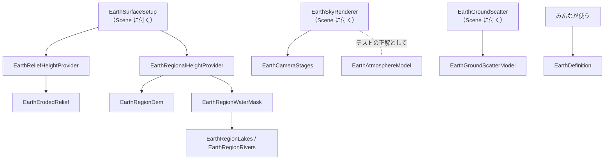

# Scene に付かない計算部品

**結論**：Earth デモには、GameObject に付けない「計算だけをする C# のクラス」がたくさんあります。
Inspector には出てきませんが、Scene に付いている部品の中で使われています。

## 一覧

| クラス | 場所（`Runtime/` の下） | 役割 |
|---|---|---|
| `EarthDefinition` | `Planet/` | 地球の定数（半径、向き、区画の細かさ、標高データの大きさ、起伏の強さ） |
| `EarthReliefHeightProvider` | `Planet/` | 標高の格子（約 14 km）に、それより細かい起伏を足して高さを返す |
| `EarthErodedRelief` | `Planet/` | 「雨で削られたような」起伏を作るノイズ。急な斜面ほど細かい凸凹を弱め、なめらかな谷と鋭い尾根にする |
| `EarthRegionalHeightProvider` | `Region/` | 地球全体の高さに、アルプスの実際の標高を、縁でなめらかに混ぜる |
| `EarthRegionDem` | `Region/` | アルプスの標高データ（EDEM 形式）を読む。緯度・経度の格子 |
| `EarthRegionLakes` / `EarthRegionRivers` | `Region/`（`EarthRegionHydrology.cs`） | 湖（ELAK 形式）と川（ERIV 形式）を読む。HydroLAKES / HydroRIVERS という公開データが元 |
| `EarthRegionWaterMask` | `Region/` | 湖と川から「水の地図」（0〜1）を作る。地表の水面と、水の上を平らにするのに使う |
| `EarthCameraStages` | `VirtualObject/` | カメラ 1 台ごとに、大気と雲をどの段で描くかを選び、0.5 秒かけて切り替える |
| `EarthAtmosphereModel` | `Sky/` | 大気の計算の「答え合わせ用」の倍精度版。GPU の LUT が正しいかを確かめるテストで使う |
| `EarthGroundScatterModel` | `Ground/` | 区画ごとの岩と木の置き方と形を、決まった種から計算する |

## 共通する約束

これらの計算クラスには、共通の約束があります。

- **同じ入力には、いつも同じ答えを返す**（決定論）。だから、同じ場所に戻れば同じ地形・同じ岩になります。
- **複数のスレッドから同時に呼んでよい**。地形の区画は、裏のスレッドでたくさん同時に作るためです。
- **壊れたデータでは描かない**。データの形が合わなければ例外を出し、`EarthSurfaceSetup` が用意を止めます。

## 高さの計算の重なり

<figure class="caption">
<svg class="fig" viewBox="0 0 720 260" width="720" role="img" aria-label="高さの計算の重なり">
  <path d="M 20 200 L 120 170 L 220 120 L 320 90 L 420 110 L 520 150 L 620 160 L 700 180" class="sb" stroke-width="3"/>
  <text x="705" y="215" text-anchor="end" font-size="13">① 標高の格子（14 km ごと）</text>
  <path d="M 20 200 L 50 190 L 80 182 L 110 168 L 140 160 L 170 140 L 200 128 L 230 112 L 260 104 L 290 86 L 320 80 L 350 92 L 380 100 L 410 104 L 440 120 L 470 130 L 500 146 L 530 150 L 560 158 L 590 154 L 620 164 L 650 170 L 700 178" class="sa" stroke-width="2"/>
  <text x="80" y="60" font-size="13">② 細かい起伏を足す（28 km〜0.5 m の波）</text>
  <rect x="300" y="40" width="160" height="200" class="c" fill-opacity=".18" stroke-width="1.5" stroke-dasharray="6 4"/>
  <text x="380" y="235" text-anchor="middle" font-size="13">③ アルプスは実際の標高</text>
</svg>
<figcaption>① 粗い格子 → ② 計算で細かい起伏を足す → ③ アルプスの範囲だけ実際の細かい標高に置き換える。</figcaption>
</figure>

!!! note "限界"
    - アルプス以外の山や谷は、実在の形ではなく「それらしく作った」形です。
    - 水の地図の格子は約 90 m なので、細い川は目の近くでぼやけた帯になります。
    - 川の幅は流量から見積もった値で、推測を含みます。
