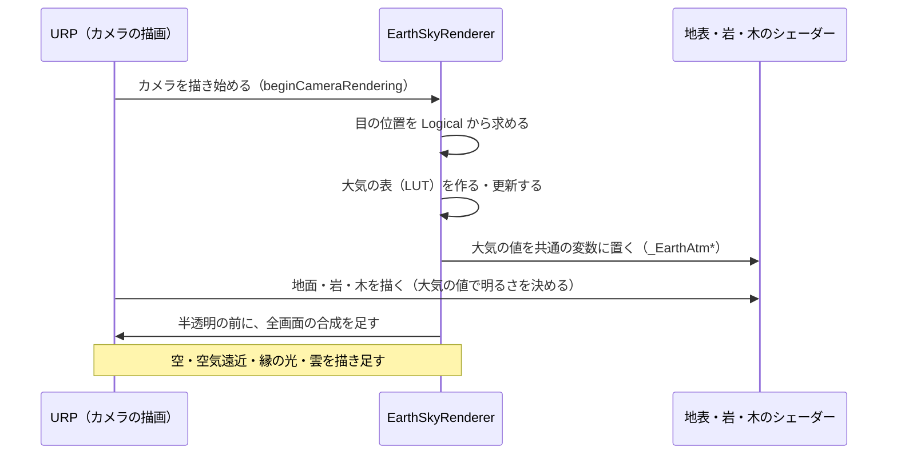

# EarthSkyRenderer（空・大気・雲）

**一言で**：地球の空の色、遠くがかすむ様子（空気遠近）、宇宙から見た地球の縁の光、雲を描く部品です。
さらに、地表・岩・木のシェーダーが使う「大気を通った太陽の光」の値も用意します。
**Earth デモの照明の中心**です。

| | |
|---|---|
| 付いている所 | `Earth` |
| ファイル | `Assets/Omni/Development/Earth/Runtime/Sky/EarthSkyRenderer.cs` |
| 名前空間 | `Omni.Earth`（アセンブリ `Omni.Earth.Runtime`） |
| いつ動くか | Edit Mode でも動く（`[ExecuteAlways]`）。Game View と Scene View の、カメラが描く直前ごと |

## たとえ：写真に「空気」を描き足す

まず地面や岩などを普通に描き終えます（不透明な物の描画）。
そのあと、できた写真の上から、空・かすみ・雲を**全画面で描き足します**。
奥行きの情報を見て、遠い所ほど強くかすませます。

## 用語：LUT（ルックアップテーブル）

大気の光の計算はとても重いので、**あらかじめ計算した表**を画像として作っておき、描くときは表を引くだけにします。
この表を **LUT** と呼びます。九九の表を覚えておけば、毎回足し算しなくてよいのと同じです。

| LUT | 中身 | 作る回数 |
|---|---|---|
| 透過率 | ある高さ・向きから宇宙まで、光がどれだけ届くか | 1 回だけ |
| 多重散乱 | 空気の中で何度も跳ね返った光の量 | 1 回だけ |
| 天空照度 | 空全体から地面に届く光の量 | 1 回だけ |
| SkyView | 今のカメラから見た空の色 | カメラごとに毎回 |

## Inspector の項目

| 項目 | 意味 |
|---|---|
| `skyShader` / `lutShader` | `EarthSky.shader` と `EarthAtmosphereLut.shader` |
| `sun` | 太陽の Light（Scene の `Sun`）。**光の向きだけを使います**。Light の明るさは使いません |
| `sunIrradiance` | 太陽の光の強さ（既定 4.08）。地表と空が同じ値を使う |
| `atmosphereHeightKm` | 大気の厚さ（100 km） |
| `multiScatteringAlbedo` | 地面から空へ返る光の割合（0.3。雲を含む地球の平均） |
| `analyticGroundDistanceKm` | これより遠い地面は、球との交点で距離を求める（20 km） |
| `atmosphereVisible` | 大気を描くか |
| `cloudMap` | 雲の分布の画像（明るいほど雲） |
| `cloudNoise` | 雲の形の 3D ノイズ（Texture3D） |
| `cloudMode` | 雲の描き方：`None`（描かない）、`Shell`（殻）、`Volume`（立体）、`Auto`（自動で切り替え。既定） |
| `cloudDensity` | 雲の濃さの倍率 |

## 雲の 2 つの描き方

<figure class="caption">
<svg class="fig" viewBox="0 0 720 220" width="720" role="img" aria-label="殻の雲と立体の雲">
  <rect x="20" y="20" width="320" height="180" rx="12" class="a" stroke-width="2"/>
  <text x="180" y="50" text-anchor="middle" font-size="16" font-weight="700">殻（Shell）</text>
  <path d="M 50 170 Q 180 90 310 170" class="sb" stroke-width="2"/>
  <path d="M 50 150 Q 180 70 310 150" class="sa" stroke-width="6" stroke-opacity=".5"/>
  <text x="180" y="190" text-anchor="middle" font-size="13">球面に薄い層として描く。遠くから見るとき</text>
  <rect x="380" y="20" width="320" height="180" rx="12" class="b" stroke-width="2"/>
  <text x="540" y="50" text-anchor="middle" font-size="16" font-weight="700">立体（Volume）</text>
  <path d="M 410 170 L 670 170" class="sb" stroke-width="2"/>
  <g class="fa" fill-opacity=".45">
    <ellipse cx="470" cy="120" rx="40" ry="22"/><ellipse cx="500" cy="105" rx="30" ry="20"/>
    <ellipse cx="600" cy="115" rx="45" ry="25"/><ellipse cx="630" cy="100" rx="25" ry="17"/>
  </g>
  <text x="540" y="190" text-anchor="middle" font-size="13">厚みのある雲を光の通り道で積み上げる。近いとき</text>
</svg>
<figcaption>`cloudMode = Auto` のとき、雲の層で 1 km が 0.5 画素より大きく見えたら立体に切り替えます。</figcaption>
</figure>

- 立体の雲は、GPU のメモリを **64 MiB まで**しか使いません。収まらないときは解像度を下げ、それでも無理なら殻に戻します。
- 切り替えは 0.5 秒かけて混ぜます（`EarthCameraStages`）。

## カメラの高さで明るさを変える

宇宙から見た地球は明るく、森の中は暗くなりがちです。
そこで、カメラが 100 km 以上では露出 1 倍、2 km 以下では 2 倍にして、間はなめらかにつなぎます。
人の目やカメラが、場面の明るさに慣れるのと同じ考え方です。

## 一緒に使う部品

| 部品 | 関係 |
|---|---|
| `Logical Transform`（同じ GameObject） | 地球の中心の位置を知る |
| `Sun`（Light） | 太陽の向きを知る |
| カメラの `RadialCamera` と `Logical Transform` | 目の位置を求める |
| `OmniPlanetPlacement`（同じ GameObject） | 奥行きから本当の距離を戻すための値を要求してくれる |
| `EarthGroundScatter` | `EarthSkyRenderer.TryGetEye` で目の位置を借りる |
| 地表・岩・木のシェーダー | このページの部品が置いた大気の値を読む |

!!! warning "つまずきやすい点"
    - 描けないときは何も描かず、理由を `Status` に残します（Console には出ません）。例：
      「太陽の Light が設定されていません。」「カメラに URP の Renderer がありません。」「目の位置を Logical から求められません。」
    - Earth は **URP のライトで地表を照らしていません**。`Sun` の Light の色や強さを変えても、地表の明るさは変わりません。向きだけが効きます。
    - 大気の値が無いと、地表は黒で描かれます。正しい光が分からないときに、それらしい色を出さないためです（Fail Closed）。
    - 共有の URP Renderer の設定は変えません。カメラが描くたびに、そのカメラにだけ処理を足します（Renderer Feature にしない）。
