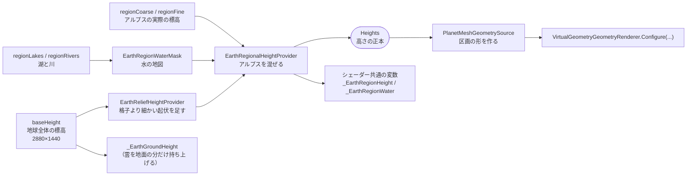

# EarthSurfaceSetup（地形を用意する司令塔）

**一言で**：標高のデータから「地球の地面の高さ」を計算する仕組みを組み立て、
同じ GameObject の `VirtualGeometryGeometryRenderer` に渡して地表を描かせる部品です。

| | |
|---|---|
| 付いている所 | `Earth` |
| ファイル | `Assets/Omni/Development/Earth/Runtime/Planet/EarthSurfaceSetup.cs` |
| 名前空間 | `Omni.Earth`（アセンブリ `Omni.Earth.Runtime`。他のデモへ移せる部品） |
| いつ動くか | Edit Mode でも動く（`[ExecuteAlways]`）。他の部品より先に動く（`[DefaultExecutionOrder(-80)]`） |

## 何をしているか

1. 標高のデータ（`baseHeight`）を読みます。地球を経度・緯度の格子に分けた 2880×1440 個の数で、海は 0 です。
   1 マスは赤道で約 14 km あります。
2. 14 km より細かい起伏を、計算で足します（`EarthReliefHeightProvider`）。
   海と海岸には足さず、平地は弱く、山地は強く足します。
3. アルプスのデータがあれば、その範囲だけ**実際の細かい標高**に置き換えます。縁はなめらかにつなぎます。
4. できあがった「高さを返す仕組み」を `Heights` として公開します。これが**高さの正本**です。
5. VG に「この高さで区画を作って描いて」と設定します。
6. シェーダーが使う地図（アルプスの標高、水の地図、地球全体の標高）を、シェーダー共通の変数に置きます。

## Inspector の項目

| 項目 | 意味 |
|---|---|
| `baseHeight` | 地球全体の標高（TextAsset。中身は float の並び）。GEBCO という公開データが元 |
| `heightWidth` / `heightRows` | 標高の格子の横と縦の数（2880 と 1440） |
| `material` | 地表を描く材質（`EarthTerrain.mat`） |
| `regionCoarse` / `regionFine` | アルプスの粗い標高と細かい標高。粗い方が無ければ、アルプスは混ぜない |
| `regionLakes` / `regionRivers` | アルプスの湖と川。水の上では細かい起伏を消して、水面を平らにする |

ふつうは手で設定しません。`EarthSceneBuilder` が Scene を組み立てるときに入れます。

## 一緒に使う部品

| 部品 | 関係 |
|---|---|
| `VirtualGeometryGeometryRenderer`（同じ GameObject） | **必須**。地形の区画を描いてもらう |
| `OmniPlanetPlacement`（同じ GameObject） | **必須**。惑星を Logical の位置に置いてもらう |
| `EarthOrbitCamera` | `Heights` を読んで、カメラが地面にもぐらないようにする |
| `EarthGroundScatter` | `Heights` を読んで、岩と木を地面に置く |

## 地球の大きさと細かさ

| 値 | 中身 | 出典 |
|---|---|---|
| 半径 | 6,371,000 m | `EarthDefinition.RadiusMeters` |
| 区画の最も深い階層 | 24（区画の 1 辺が約 0.6 m） | `EarthDefinition.MaximumLevel` |
| 区画の目標の大きさ | 画面で 4 画素 | `EarthDefinition.TargetPixels` |
| 区画を持てる数 / 同時に描く数 | 3,072 / 2,304 | `EarthDefinition.PoolCapacity`、`DrawSlots` |
| 起伏を足す範囲 | 約 28 km の波から 0.5 m の波まで | `EarthDefinition.Relief*` |

向きは「+Y が北極、+X が経度 0 度、+Z が東経 90 度」です。EarthToMoon デモの地球（+Z が北極）とは違うので注意してください。

!!! warning "つまずきやすい点"
    - 必要な部品やデータが足りないと、Console に `[Earth]` で始まるエラーを出して、地表を用意しません。
      例：「VirtualGeometryGeometryRenderer と OmniPlanetPlacement が必要です。」
      「標高のデータと材質が設定されていません。EarthSceneBuilder を実行してください。」
    - 一度失敗すると、そのままでは再挑戦しません。Edit Mode では、部品を無効にして有効に戻すと片付けてやり直します。
    - Edit Mode では、区画の組み立てが進んでいる間だけ画面の更新を頼みます。止まって見えても、組み立てが終わっただけです。
    - 山や谷の形は、アルプス以外では**実在の地形ではありません**。14 km の格子から「それらしく作った」形です。
