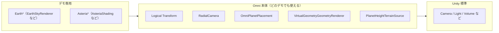

# デモの部品

**結論**：デモは「Omni でこんなことができる」という見本です。製品そのものではありません。
デモには、そのデモ専用の部品がたくさんあります。この章では、それらが何をしているかを説明します。

## デモの一覧

| デモ | 場所 | 立場 | 見せるもの |
|---|---|---|---|
| **Earth** | `Development/Earth/` | 開発用（まだ配らない） | 宇宙から目の高さ 1.7 m まで降りられる地球 |
| **Asteria** | `Development/Asteria/` | 開発用（0.1.0 に入れない。0.3 で公開の予定） | 人工惑星に到着して地上に降りるまでの約 10 分の物語 |
| EarthToMoon | `Demos/EarthToMoon/` | 公開デモ | 地球から月への移動と、月面の細部 |
| SolarSystem | `Demos/SolarSystem/` | 公開デモ | 太陽・8 惑星・衛星など 32 の天体を、本当の大きさ・距離・時刻で |
| CosmicScale | `Demos/CosmicScale/` | 公開デモ（3 つの Scene） | 陽子から観測できる宇宙までの大きさの比べ |
| Moon | `Demos/Moon/` | 公開デモ | 月のデータの読み込み（ストリーミング） |

太字の 2 つは、この文書で部品を詳しく説明しています。ほかは [ほかのデモ](others.md) で短く紹介します。

## 部品の 3 つの種類

デモの Scene に付いている部品は、次の 3 つに分けられます。

**見分け方**：

- 名前が `Earth` や `Asteria` で始まる → そのデモ専用。
- 名前が `Omni`、`Radial`、`VirtualGeometry`、`Planet` で始まる、または `Logical Transform` → Omni 本体。
- それ以外の見慣れた名前（`Camera`、`Light`、`Volume` など） → Unity 標準。

## デモの部品に共通するパターン

Earth と Asteria の部品を読むと、同じ作り方が何度も出てきます。先に知っておくと読みやすくなります。

| パターン | 中身 | 例 |
|---|---|---|
| **組み立て道具が Scene を作る** | Scene は手で組まず、Editor のスクリプトが作る。部品の設定も道具が `Configure(...)` で入れる | `EarthSceneBuilder`、`AsteriaSceneBuilder` |
| **形は実行中に計算で作る** | 地形・岩・建物などの Mesh を保存せず、実行中に作る。Scene には保存しない（`DontSave`） | `EarthGroundScatter`、`AsteriaCity` |
| **決定論** | 同じ場所・同じ種なら、いつも同じ形になる | 岩の置き方、都市の計画 |
| **近くだけ作る** | カメラの近くの区画だけ Mesh を作り、離れたら片付ける | 岩、木、都市、峡谷 |
| **シェーダー共通の変数で受け渡す** | `Shader.SetGlobal...` で置いた値を、多くのシェーダーが読む | `_EarthAtm*`、`_Asteria*` |
| **URP のライトを使わない** | 太陽の向きなどを部品が配り、専用のシェーダーが明るさを計算する | `EarthSkyRenderer`、`AsteriaShading` |
| **描けないときは理由を残して止まる** | 部品やデータが足りないと、それらしい絵を出さずに止まる | `EarthSurfaceSetup.Failure`、`EarthSkyRenderer.Status` |
| **Scene BRG に登録して描く** | 作った Mesh を `RadialBatchRendererRegistry` に登録して、まとめて描く | 岩、木、構造物 |
