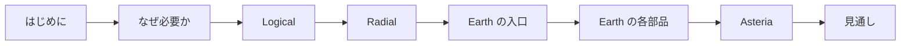

# 読む順番と用語集

## おすすめの読む順番

時間がないときは、[はじめに](index.md) → [Earth の入口](demos/earth/index.md) → [デモの部品に共通するパターン](demos/index.md) だけでも、全体の形がつかめます。

## 用語集

### Unity とゲーム作りの言葉（はじめての人向け）

| 言葉 | 意味 |
|---|---|
| **ゲームエンジン** | ゲームを作るための土台の道具。絵を描く・音を鳴らす・物を動かす、といった共通の仕事を引き受ける |
| **Unity** | 世界で広く使われているゲームエンジンの 1 つ。スマホゲームから家庭用ゲームまで使われている。Omni はこの Unity に足す拡張 |
| **URP** | Unity に入っている、絵を描くための標準の仕組み（Universal Render Pipeline） |
| **Scene（シーン）** | ゲームの 1 つの場面。ステージや部屋のようなもの。Unity ではファイル 1 つ（`.unity`） |
| **GameObject** | Scene に置く「物」。キャラクター、壁、カメラ、ライトなど、何でも GameObject |
| **コンポーネント（部品）** | GameObject に付けて機能を足す部品。「カメラの部品」を付けるとカメラになり、「光の部品」を付けるとライトになる |
| **Hierarchy（ヒエラルキー）** | Scene の中の GameObject を、親子の木の形で並べた一覧の画面 |
| **Inspector（インスペクター）** | 選んだ GameObject に付いている部品と、その設定を見る・変える画面 |
| **Transform** | どの GameObject にも必ず付いている、位置・向き・大きさの部品 |
| **親子（親 / 子）** | GameObject は別の GameObject の下に入れられる。親を動かすと、子も一緒に動く |
| **シェーダー** | 物の表面の色や明るさを計算する、GPU の小さなプログラム |
| **焼き込み（Bake）** | 重い光の計算を前もって済ませ、結果を保存しておくこと。ゲーム中は保存した結果を読むだけなので軽い |
| **GI（間接光）** | 光が壁や床に当たって跳ね返り、まわりを照らす光。赤い壁の近くの物がほんのり赤くなる、など |
| **Lightmap（ライトマップ）** | 焼き込んだ明るさを、動かない物の表面に貼る画像 |
| **Light Probe（ライトプローブ）** | 空間のあちこちに置く「明るさのメモ」。動く物は近くのメモを読んで明るさを決める |
| **APV（Adaptive Probe Volume）** | Light Probe を自動で格子状に並べる、Unity 6 の新しい仕組み |

### Omni の言葉

| 言葉 | 意味 | くわしく |
|---|---|---|
| **Logical** | 位置と向きの「本当の値」。192 ビットの固定小数点 | [Logical](basics/logical.md) |
| **Logical Transform** | Logical の値を持つ部品（`Omni.Logical.Transform`） | [Logical](basics/logical.md) |
| **正本** | いくつか写しがあるときの「元になる本物」。Omni では Logical の値が正本 | [Logical](basics/logical.md) |
| **表示用の写し（Proxy）** | 正本から作った、表示のための値。Unity の `Transform` など | [Logical](basics/logical.md) |
| **安全域** | Unity の `Transform` に本当の値に近い数を入れてよい範囲。原点から ±1 万 m | [Logical](basics/logical.md) |
| **Radial** | カメラからの距離を対数で縮めて描く仕組み | [Radial](basics/radial.md) |
| **RadialCamera** | Radial の設定を持つ、カメラの部品 | [Radial](basics/radial.md) |
| **View Scale（M）** | どの距離から縮め始めるかを決める値。`Camera の Near ÷ nearClip` | [Radial](basics/radial.md) |
| **論理 Near / Far** | 「カメラの Near 面と Far 面が、本当は何 m を表すか」 | [Radial](basics/radial.md) |
| **奥行き線形補間 / 奥行き対数補間 / 交点方式 / 近傍切り出し** | 長い三角形の奥行きを正しく描くための 4 つの方式 | [Radial](basics/radial.md) |
| **Legacy Renderer** | 1 つずつ描くふつうの道筋 | [描く道筋](basics/rendering-paths.md) |
| **Scene BRG** | Scene の物をまとめて描く道筋（Unity の BatchRendererGroup を使う） | [描く道筋](basics/rendering-paths.md) |
| **変換器** | 今あるシェーダーを Radial 用に作り直す道具 | [シェーダーの変換](basics/shader-conversion.md) |
| **GUID 台帳** | 生成物の背番号の一覧。`ProjectSettings/Omni/Generated.manifest.json` | [シェーダーの変換](basics/shader-conversion.md) |
| **Fail Closed** | 正しくできないときは、それらしい結果を出さずに止めること | [照明と「止める」考え方](basics/lighting.md) |
| **Physical Lighting Data** | 光の計算に使う「本当の位置」の情報 | [照明と「止める」考え方](basics/lighting.md) |
| **Hit / Miss / Unavailable** | クリックで選ぶときの「当たった・外れた・分からない」 | [クリックで選ぶ](basics/picking.md) |
| **VirtualGeometry（VG）** | 見える大きさに合わせた細かさで形を描く仕組み | [VirtualGeometry](basics/virtual-geometry.md) |
| **Cell（区画）** | VG で地形を分けた 1 マス。近いほど細かく割る | [VirtualGeometry](basics/virtual-geometry.md) |
| **VO（Virtual Object）** | 画面でどれくらいの大きさに見えるかで、描き方そのものを変える層 | [VirtualGeometry](basics/virtual-geometry.md) |
| **段（レベル）** | VO の描き方の切り替えの 1 つ 1 つ。例：大気を「描かない段」「描く段」 | [Earth](demos/earth/index.md) |
| **検証 Hub** | 買った人が自分の環境で Omni が正しく動くかを確かめる Scene の集まり | [考え方](outlook/philosophy.md) |

### 一般的な言葉

| 言葉 | 意味 |
|---|---|
| **float / double** | コンピューターの小数。`float` は約 7 桁、`double` は約 16 桁まで正確 |
| **固定小数点** | 小数点の位置が決まっている数。どの大きさでも細かさが同じ |
| **奥行きバッファ（Z バッファ）** | 画面の各点が、カメラからどれだけ遠いかを書いておく場所 |
| **Near / Far** | カメラが描く一番手前と一番奥の距離 |
| **補間** | 角（頂点）の値から、間の値を直線などでつないで決めること |
| **LUT（ルックアップテーブル）** | 重い計算の結果を前もって表（画像）にしておき、描くときは引くだけにするもの |
| **シェーダー共通の変数（グローバル変数）** | `Shader.SetGlobal...` で置く、どのシェーダーからも読める値 |
| **決定論** | 同じ入力なら、いつも同じ結果になること |
| **四分木** | 1 マスを 4 つに割り、必要な所だけさらに 4 つに割っていく分け方 |
| **cube-sphere（立方体球）** | 立方体の 6 面を膨らませて球にしたもの。地形を区画に分けやすい |
| **LOD** | Level of Detail。遠い物ほど粗い形で描くこと |
| **Bloom** | 明るい所の光がにじむように見せる後処理 |
| **露出 / 目の順応** | 画面の明るさの調整。暗い所で画面を明るくするなど |
| **Renderer Feature** | URP の描画に、処理を足すための仕組み |
| **Timeline** | Unity で、時間に沿ってカメラや動きを並べる道具 |
| **Addressables** | Unity で、データを後から読み込む・配信するための仕組み |
| **WebGPU** | ブラウザーで GPU を使う新しい仕組み。Omni の Web 版はこれだけを使う |
| **Direct3D 12 / Vulkan / Metal** | GPU に命令を出すための仕組み（Graphics API）の種類 |
