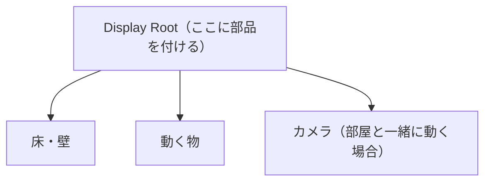

# Light Probe と APV を正しく読む

**このページでできること**：原点の近くで焼いた照明を、遠くへ動かした部屋でも正しい明るさで読めるようにします。
部品の仕組みは [照明の空間をそろえる部品](../basics/lighting-spaces.md) で説明しています。

## まず違いを見る

下の 2 本は、同じ部屋（表示の Root）を遠くへ動かしている動画です。カメラも部屋と一緒に動くので、正しければ**見た目は変わらない**はずです。

<figure class="caption">
<video autoplay muted loop playsinline preload="metadata" poster="../../assets/videos/lighting/apv-without-space-first.png">
  <source src="../../assets/videos/lighting/apv-without-space.mp4" type="video/mp4">
</video>
<figcaption><strong>部品なし</strong>：部屋が動くと、APV を違う場所で読み、明るさが変わってしまう。</figcaption>
</figure>
<figure class="caption">
<video autoplay muted loop playsinline preload="metadata" poster="../../assets/videos/lighting/apv-with-space-first.png">
  <source src="../../assets/videos/lighting/apv-with-space.mp4" type="video/mp4">
</video>
<figcaption><strong>部品あり</strong>（<code>OmniAdaptiveProbeVolumeSpace</code>）：部屋が動いても、焼いた場所で読むので明るさが変わらない。</figcaption>
</figure>

見るところは**真ん中の球**です。球だけが APV（焼いた明るさのメモ）で照らされています。壁と床は Lightmap なので、どちらの動画でも変わりません。

- 部品なし：部屋が動くにつれ、球が黄色から青へ変わります。APV の格子の、焼いたのとは違う場所を読んでいるからです。
- 部品あり：球の色は最後まで同じです（画面中央の明るさの差は 0.00001 未満）。

動画は、Omni の照明の見本 Scene `Assets/Omni/Development/Scenes/Lighting/AdaptiveProbeVolumes.unity` を撮ったものです。
部屋（`Finite Bake Space`）を 1 秒止めてから、3 秒かけて (74, 364, −2419) m だけ動かしています。

## 始める前に

- [ ] 描く道筋は **Scene BRG**（Light Probe の場合）。APV はどちらの道筋でも効きます。
- [ ] 照明の焼き込み（Bake）は、**原点の近く**（1 万 m の内側）で済ませてある。
- [ ] 動かす物が、1 つの親（**表示の Root**）の下にまとまっている。

## 手順 1：表示の Root を決める

動かす部屋の物を、1 つの空の GameObject の下にまとめます。これが**表示の Root** です。
部屋を動かすときは、この Root だけを動かします。

## 手順 2：OmniLightProbeSpace を足す

1. Hierarchy で表示の Root を選びます。
2. Inspector の **Add Component** を押し、`Omni Light Probe Space` と入力して選びます。

!!! info "Inspector の見え方（画像は準備中）"
    足した直後の Inspector には、項目 **Baked Space Root** が 1 つだけあります。
    その下に、見出し「Light Probe空間の検証」と **Validate** ボタンが並びます。

3. **Baked Space Root** を決めます。
    - 原点（0, 0, 0）を中心に焼いた場合：**空のまま**にします。
    - 焼いたときの部屋の親が別にある場合：その GameObject をドラッグします。表示の Root と**同じ Scene** の物にしてください。

!!! tip "Requirement（約束の札）も足す"
    Add Component で `Omni Light Probe Space Requirement` も同じ Root に足します。
    札があると、あとで誰かが部品を消してしまったとき、ビルドが止まって気づけます。
    札の値は Inspector に出ません。手順 3 の自動修復か、スクリプトの
    [`OmniLightProbeSpaceAuthoring.TryEnsureContract`](../api/Omni.Editor.BatchRendering.OmniLightProbeSpaceAuthoring.md) が書きます。

## 手順 3：Validate で確かめる

Inspector の **Validate** を押します。押しても Scene は変わりません。

!!! info "Validate の結果の見え方（画像は準備中）"
    ボタンの下に、次の行が出ます。
    `Scene:`、`状態:`、`対象Renderer数:`、`理由:`、`Probe範囲:`（焼いた Light Probe の範囲）、`現在のsample範囲:`（今、物が明るさを読む位置の範囲）。
    足せる場合は `修復後のsample予測範囲:` も出ます。

「状態」を見て、次のようにします。

| 状態 | すること |
|---|---|
| 正常 / 対象外 | 何もしなくてよい |
| 不足（安全に修復可能） | 「**確認してLight Probe空間を追加…**」を押し、確認の窓で「追加」を押す。部品と札が足され、Baked Space Root は空（原点）になる |
| 不足候補（要手動確認） | 足す先が 1 つに決まらない。「候補Rootを選択」で候補を見て、手順 2 を自分で行う |
| 明示契約違反 | 札と部品の設定が合っていない。Baked Space Root を札と同じにする。このままではビルドが止まる |

修復のあと、**Scene は自動で保存されません**。確かめてから保存してください（元に戻すときは Undo）。

## 手順 4：APV を使うときは OmniAdaptiveProbeVolumeSpace も足す

APV（Adaptive Probe Volume）を使う Scene では、同じ表示の Root に次を足します。

1. Add Component で `Omni Adaptive Probe Volume Space` を足します。`Omni Light Probe Space` と `Volume` が無ければ一緒に付きます。
2. `Omni Adaptive Probe Volume Space Requirement` も足します。`Omni Light Probe Space Requirement` が無ければ一緒に付きます。
3. 同じ Root の **Volume** を、次のとおりにします。

| 項目 | 値 |
|---|---|
| Mode | Global |
| Weight | 1 |
| Priority | 最大（`3.402823e+38`。ほかの Volume より後で効かせるため） |
| Blend Distance | 0 |
| Profile | 新しく作る（中身は空でよい。実行中に部品が World Offset を足す） |

!!! info "見本 Scene の表示の Root（画像は準備中）"
    `AdaptiveProbeVolumes.unity` の `Finite Bake Space` には、次の部品が付いています。
    Volume、Omni Light Probe Space、Omni Light Probe Space Requirement、Omni Adaptive Probe Volume Space、Omni Adaptive Probe Volume Space Requirement。

!!! warning "APV で守ること"
    - 表示の Root は**動かすだけ**にします。回転や拡大をすると、ずれを World Offset で表せず、部品は上書きを外します。
    - この部品を有効にしてよいのは、読み込んでいる Scene 全体で **1 つだけ**です。

手で付ける代わりに、スクリプトから
[`OmniAdaptiveProbeVolumeSpaceAuthoring.TryEnsureContract`](../api/Omni.Editor.BatchRendering.OmniAdaptiveProbeVolumeSpaceAuthoring.md)
を呼ぶと、部品・札・Volume をまとめて条件どおりに付けます（途中で失敗したら元に戻します）。

## 手順 5：動かして確かめる

1. 表示の Root の Position を、大きく変えます（例：Z を −2000）。
2. Scene View か Game View で、物の明るさが変わらないことを確かめます。
3. Play して、Console にエラー `Omni APV space mapping is unavailable:` が出ないことを確かめます。出たら、続く理由の文を読みます。

| エラーの理由（英語） | 意味と直し方 |
|---|---|
| `APV worldOffset cannot represent multiple active mappings.` | 部品が 2 つ以上有効。1 つにする |
| `An active APV space mapping is required.` | 有効な部品が無い |
| `The APV worldOffset Volume must be active, global, full-weight, zero-blend, and at the reserved priority.` | Volume の設定が手順 4 の表と違う |
| `The APV baked-space root must belong to the display root scene.` | Baked Space Root が別の Scene の物 |
| `APV worldOffset requires matching display and baked-space basis.` | 表示の Root と焼いた場所の Root で回転か拡大が違う。動かすだけにする |
| `APV display or baked-space matrix is non-finite or singular.` / `APV worldOffset is non-finite.` | 位置や拡大に無限大・0 が入っている。Transform の値を直す |

## ビルドのとき

札（Requirement）がある Scene は、ビルドのときに点検されます。
部品が無い、設定が札と違う、などのときは**ビルドが止まります**。止まったら、表示の Root の Inspector で Validate を押して直します。

## 関連

- [照明の空間をそろえる部品](../basics/lighting-spaces.md)（仕組み）
- [照明と「止める」考え方](../basics/lighting.md)
- API：[`OmniLightProbeSpace`](../api/Omni.Lighting.OmniLightProbeSpace.md)、[`OmniLightProbeSpaceRequirement`](../api/Omni.Lighting.OmniLightProbeSpaceRequirement.md)、[`OmniAdaptiveProbeVolumeSpace`](../api/Omni.Lighting.OmniAdaptiveProbeVolumeSpace.md)、[`OmniAdaptiveProbeVolumeSpaceRequirement`](../api/Omni.Lighting.OmniAdaptiveProbeVolumeSpaceRequirement.md)、[`OmniLightingSpace`](../api/Omni.Lighting.OmniLightingSpace.md)
