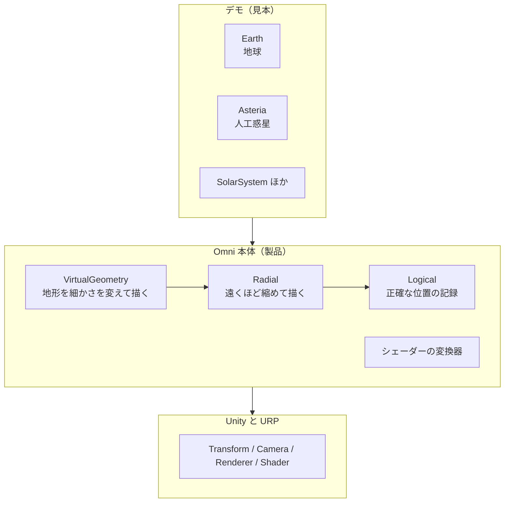

# Omni 入門リファレンス

この文書は、Unity で「とても大きな世界」を描くための仕組み **Omni** の入門書です。

読む人として、次のような人を想定しています。

- Unity でゲームを作り始めて 1 年くらい。
- `Transform`、`Camera`、`Material`、`Shader` という言葉は聞いたことがある。
- 浮動小数点や GPU の細かい話は、まだよく知らない。

## Omni を一言でいうと

> 原子より小さなものから、宇宙全体までを、**1 台のカメラ**でそのまま描くための Unity の拡張です。

Unity は、ふつう数 km くらいの広さの世界を作るように出来ています。
それより大きくすると、物が震えたり、奥にある物が手前に出てきたりします。
Omni は、この限界を 2 つの工夫で越えます。

<figure class="caption">
<svg class="fig" viewBox="0 0 720 260" width="720" role="img" aria-label="Omni の 2 つの工夫：正確な住所録と、遠くほど縮む物差し">
  <rect x="10" y="10" width="340" height="240" rx="14" class="a" stroke-width="2"/>
  <text x="180" y="44" text-anchor="middle" font-size="20" font-weight="700">① Logical</text>
  <text x="180" y="70" text-anchor="middle" font-size="15" class="muted">正確な住所録</text>
  <rect x="50" y="90" width="260" height="130" rx="6" class="bg" stroke="currentColor" stroke-opacity=".2"/>
  <text x="66" y="118" font-size="14">地球 …… 1.496×10¹¹ m 先</text>
  <text x="66" y="146" font-size="14">月の岩 …… 3.84×10⁸ m 先</text>
  <text x="66" y="174" font-size="14">足元の小石 …… 0.003 m 先</text>
  <text x="66" y="202" font-size="13" class="muted">どこでも同じ細かさで記録</text>
  <rect x="370" y="10" width="340" height="240" rx="14" class="b" stroke-width="2"/>
  <text x="540" y="44" text-anchor="middle" font-size="20" font-weight="700">② Radial</text>
  <text x="540" y="70" text-anchor="middle" font-size="15" class="muted">遠くほど目盛りが詰まる物差し</text>
  <line x1="400" y1="160" x2="690" y2="160" class="ink" stroke-width="2"/>
  <g class="ink" stroke-width="2">
    <line x1="400" y1="150" x2="400" y2="170"/><line x1="490" y1="150" x2="490" y2="170"/>
    <line x1="560" y1="150" x2="560" y2="170"/><line x1="610" y1="150" x2="610" y2="170"/>
    <line x1="645" y1="150" x2="645" y2="170"/><line x1="668" y1="150" x2="668" y2="170"/>
    <line x1="682" y1="150" x2="682" y2="170"/><line x1="690" y1="150" x2="690" y2="170"/>
  </g>
  <text x="400" y="195" text-anchor="middle" font-size="12">0</text>
  <text x="490" y="195" text-anchor="middle" font-size="12">1 m</text>
  <text x="560" y="195" text-anchor="middle" font-size="12">1 km</text>
  <text x="610" y="195" text-anchor="middle" font-size="12">10⁶</text>
  <text x="652" y="215" text-anchor="middle" font-size="12">… 宇宙の端</text>
  <text x="540" y="110" text-anchor="middle" font-size="14">近くは広く、遠くは詰めて</text>
  <text x="540" y="130" text-anchor="middle" font-size="14">1 枚の画面に全部おさめる</text>
</svg>
<figcaption>Omni の 2 本柱。① で「どこにあるか」を正確に覚え、② で「どう見せるか」を決めます。</figcaption>
</figure>

1. **Logical（ロジカル）**：物の位置を、とても細かく正確に記録する「住所録」です。
   Unity の `Transform` は、この住所録から作った「表示用の写し」になります。
2. **Radial（ラディアル）**：カメラから遠いほど目盛りが詰まる「物差し」です。
   近くの物は大きく、遠くの物は縮めて、1 枚の画面と 1 枚の奥行きにおさめます。

## 全体の地図

Omni は、Unity と URP（Unity の標準的な描画の仕組み）の**上に乗る**形で作られています。
自分でゲームエンジンを作り直すのではありません。

- **デモ**は「Omni でこんなことが出来ます」という見本です。製品そのものではありません。
- デモの中には、そのデモ専用の部品（コンポーネント）がたくさんあります。
  例えば `EarthSkyRenderer` は地球の空を描く、Earth デモ専用の部品です。
- **Omni 本体**の部品（`RadialCamera`、`Logical.Transform`、`OmniPlanetPlacement` など）は、どのデモでも使えます。

## 読む順番

| 知りたいこと | 読むところ |
|---|---|
| そもそも何が困るのか | [なぜ必要か](basics/why.md) |
| Omni の仕組み | [Omni の基本](basics/index.md) の各ページ |
| Earth.unity の部品が何をしているか | [Earth（地球）](demos/earth/index.md) |
| Asteria の部品が何をしているか | [Asteria（人工惑星）](demos/asteria/index.md) |
| 何が得意で、何が苦手か | [良いところ・苦手なところ](outlook/pros-cons.md)、[限界と対応環境](outlook/limits.md) |
| これからどうなるか | [これから](outlook/roadmap.md) |
| 言葉の意味 | [用語集](glossary.md) |

!!! note "この文書の書き方"
    - 書いてあることは、2026 年 11 月時点のコードと開発用の文書で確かめた内容です。
    - まだ確かめていないことは「未確認」と書いています。
    - 日付つきの将来の予定は、すべて「目安」です。
