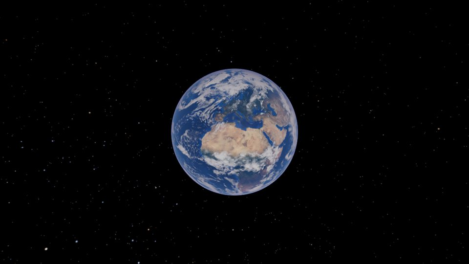
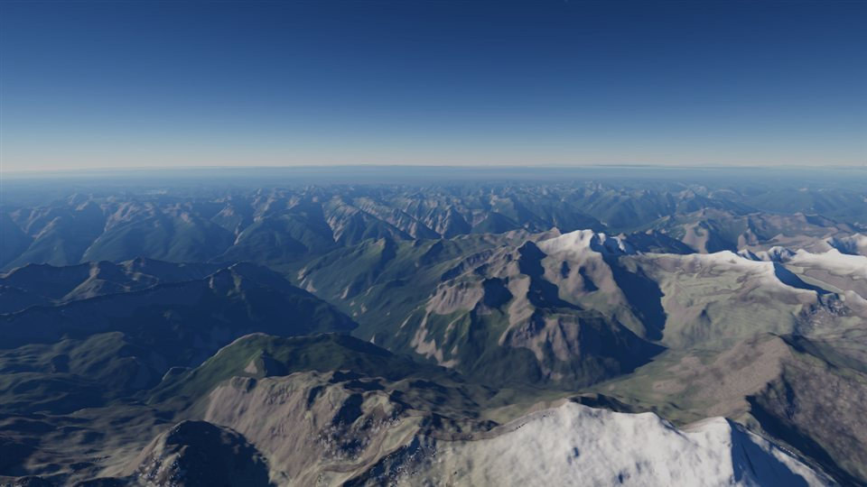
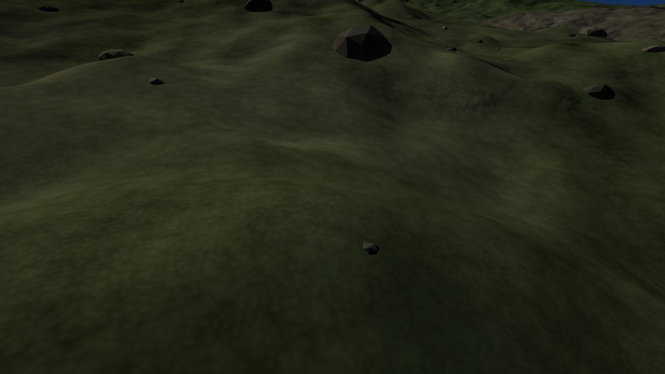
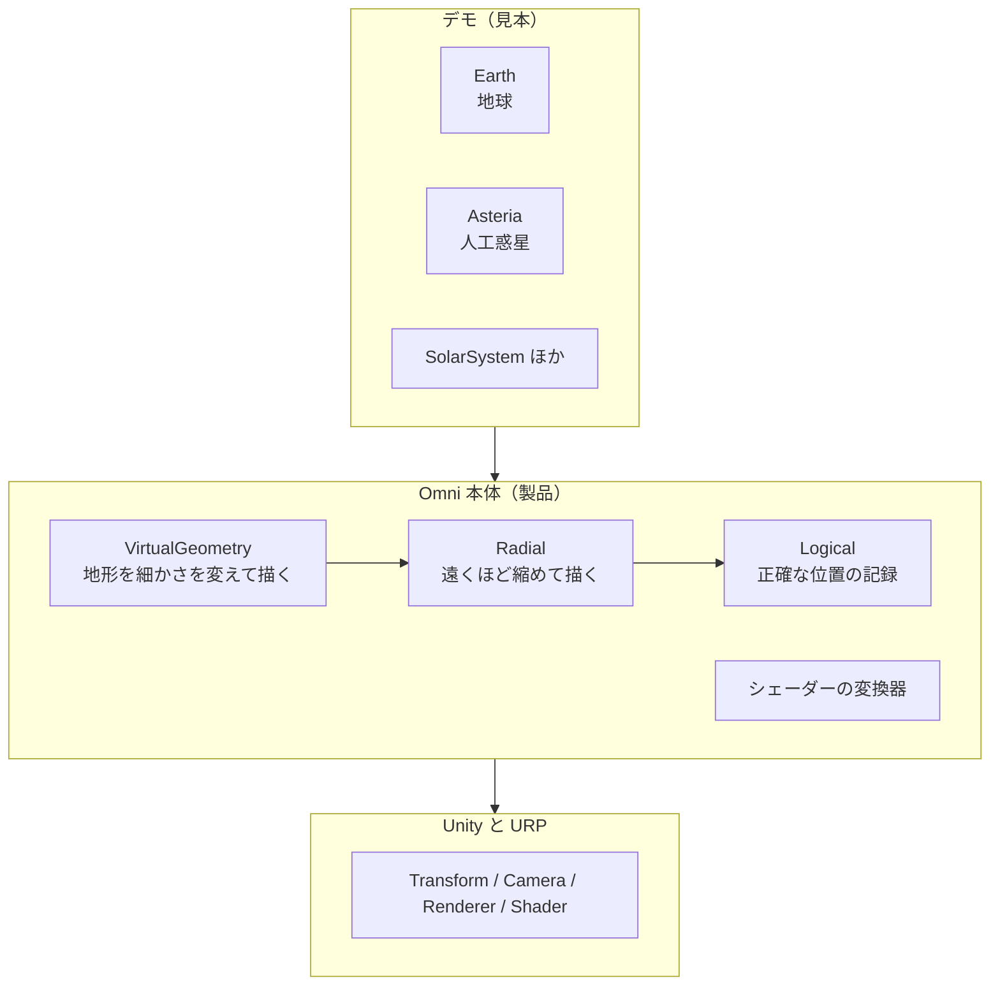

# Omni 入門リファレンス

**宇宙から見た地球から、地面に立つ人の足元まで。1 つの世界として、1 台のカメラでつなげて描く。**
Omni は、そのための仕組みです。

今まで（Unity の標準のまま）

<figure class="caption">
<video autoplay muted loop playsinline preload="metadata" poster="assets/videos/intro/standard-origin-first.jpg">
  <source src="assets/videos/intro/standard-origin.mp4" type="video/mp4">
</video>
<figcaption>小さな庭を、世界の中心（原点）に置いて歩く。きれいに描ける。</figcaption>
</figure>
<figure class="caption">
<video autoplay muted loop playsinline preload="metadata" poster="assets/videos/intro/standard-far-first.jpg">
  <source src="assets/videos/intro/standard-far.mp4" type="video/mp4">
</video>
<figcaption><strong>同じ庭を、地球の半径ほど（約 640 万 m）離れた場所に置くと</strong>、球は角ばった塊に崩れ、細い柱と人の形は消え、歩くと画面がガタガタ跳ぶ。</figcaption>
</figure>

Omni

<figure class="caption">

<figcaption>宇宙から見た地球。</figcaption>
</figure>
<figure class="caption">

<figcaption>そのまま降りて、高さ 3 km の山脈。</figcaption>
</figure>
<figure class="caption">

<figcaption>目の高さ 1.7 m の地面。足元の岩まで、<strong>同じ 1 つの世界・同じ 1 台のカメラ</strong>で描いている。</figcaption>
</figure>

<small>撮り方：左は Unity 6.6 と URP の標準の部品（Transform・Camera・URP Lit）だけで作った Scene を、Omni の撮影の道具で描いたもの。右は Omni の Earth デモ（開発中、2026 年 11 月）の画面。</small>

## ゲームを遊ぶ人へ：何がすごいのか

- ふつうのゲームの世界は、広くても**数 km 四方**です。オープンワールドの大きな地図でも、たいていこの範囲に収まっています。
- それより広い世界を作ると、コンピューターの計算の「目盛り」が足りなくなります。物の形が崩れたり、ガタガタ震えたり、奥の物が手前に出てきたりします（上の左の動画）。
- そのため、宇宙と地上が出てくるゲームの多くは、**場面を切り替え**たり、**遠くの物を絵（背景）でごまかし**たりしています。
- Omni は、地球の大きさでも、原子の大きさでも同じ細かさで位置を覚え、遠くの物は縮めて描きます。だから、**宇宙から地上まで、切り替えなしにそのまま降りられます**（上の右）。

!!! info "Unity とは"
    **Unity** は、ゲームを作るための道具（ゲームエンジン）です。スマホゲームから家庭用ゲームまで、世界中で使われています。
    Omni は Unity に**足して使う拡張**で、Unity の中で「とても大きな世界」を描けるようにします。
    この文書に出てくる Unity の言葉（Scene、GameObject、コンポーネントなど）は、[用語集](glossary.md) で短く説明しています。

## この文書の 3 つの部分

| 部分 | こんな人に | 入口 |
|---|---|---|
| **説明**（しくみ） | 何が出来るのか、なぜ必要なのかを知りたい。Unity を知らなくても読める | [なぜ必要か](basics/why.md) → [Omni の基本](basics/index.md) |
| **使い方**（手順） | 自分の Scene で、部品を付けて動かしたい（Unity を使う人向け） | [使い方](guides/index.md) |
| **API リファレンス** | スクリプトから Omni を呼びたい（プログラマー向け） | [API リファレンス](api/index.md) |

デモで使っている部品の役割は [デモの部品](demos/index.md)、得意・苦手と将来は [見通し](outlook/index.md) にあります。

## Unity を使っている人へ

ここから先は、次のような人を想定しています。

- Unity でゲームを作り始めて 1 年くらい。
- `Transform`、`Camera`、`Material`、`Shader` という言葉は聞いたことがある。
- 浮動小数点や GPU の細かい話は、まだよく知らない。

## Omni を一言でいうと

> 原子より小さなものから、宇宙全体までを、**1 台のカメラ**でそのまま描くための Unity の拡張です。

Unity は、ふつう数 km くらいの広さの世界を作るように出来ています。
それより大きくすると、物が震えたり、奥にある物が手前に出てきたりします。
Omni は、この限界を 2 つの工夫で越えます。

<figure class="caption">
<svg class="fig" viewBox="0 0 720 260" width="720" role="img" aria-label="Omni の 2 つの工夫：正確な住所録と、カメラからの距離を対数で写す物差し">
  <rect x="10" y="10" width="340" height="240" rx="14" class="a" stroke-width="2"/>
  <text x="180" y="44" text-anchor="middle" font-size="20" font-weight="700">① Logical</text>
  <text x="180" y="70" text-anchor="middle" font-size="15" class="muted">正確な住所録</text>
  <rect x="50" y="90" width="260" height="130" rx="6" class="bg" stroke="currentColor" stroke-opacity=".2"/>
  <text x="66" y="118" font-size="14">太陽 …… 1.496×10¹¹ m 先</text>
  <text x="66" y="146" font-size="14">月 …… 3.84×10⁸ m 先</text>
  <text x="66" y="174" font-size="14">足元の小石 …… 0.003 m 先</text>
  <text x="66" y="202" font-size="13" class="muted">どこでも同じ細かさで記録</text>
  <rect x="370" y="10" width="340" height="240" rx="14" class="b" stroke-width="2"/>
  <text x="540" y="44" text-anchor="middle" font-size="20" font-weight="700">② Radial</text>
  <text x="540" y="70" text-anchor="middle" font-size="15" class="muted">遠い距離ほど縮めて描く物差し</text>
  <text x="540" y="105" text-anchor="middle" font-size="14">カメラからの距離を対数で写す</text>
  <text x="540" y="127" text-anchor="middle" font-size="12">例：View Scale M = 1</text>
  <line x1="400" y1="160" x2="680" y2="160" class="ink" stroke-width="2"/>
  <g class="ink" stroke-width="2">
    <line x1="400" y1="150" x2="400" y2="170"/><line x1="422" y1="150" x2="422" y2="170"/>
    <line x1="466" y1="150" x2="466" y2="170"/><line x1="532" y1="150" x2="532" y2="170"/>
    <line x1="598" y1="150" x2="598" y2="170"/><line x1="664" y1="150" x2="664" y2="170"/>
  </g>
  <text x="400" y="192" text-anchor="middle" font-size="12">0</text>
  <text x="422" y="210" text-anchor="middle" font-size="12">1</text>
  <text x="466" y="192" text-anchor="middle" font-size="12">7</text>
  <text x="532" y="192" text-anchor="middle" font-size="12">63</text>
  <text x="598" y="192" text-anchor="middle" font-size="12">511</text>
  <text x="664" y="192" text-anchor="middle" font-size="12">4095 m</text>
  <text x="690" y="232" text-anchor="end" font-size="12">さらに遠くへ →</text>
</svg>
<figcaption>Omni の 2 本柱。① で「どこにあるか」を正確に覚え、② で「どう見せるか」を決めます。</figcaption>
</figure>

1. **Logical（ロジカル）**：物の位置を、とても細かく正確に記録する「住所録」です。
   Unity の `Transform` は、この住所録から作った「表示用の写し」になります。
2. **Radial（ラディアル）**：カメラからの距離を対数で写す「物差し」です。
   近い距離はほぼ比例し、遠い距離ほど強く圧縮します。上の目盛りは M = 1 の例で、数値は実際の距離です。
   近くから非常に遠くまでを、1 台のカメラで描きやすくします。

## 全体の地図

Omni は、Unity と URP（Unity の標準的な描画の仕組み）の**上に乗る**形で作られています。
自分でゲームエンジンを作り直すのではありません。

- **デモ**は「Omni でこんなことが出来ます」という見本です。製品そのものではありません。
- デモの中には、そのデモ専用の部品（コンポーネント）がたくさんあります。
  例えば `EarthSkyRenderer` は地球の空を描く、Earth デモ専用の部品です。
- **Omni 本体**の部品（`RadialCamera`、`Logical.Transform`、`OmniPlanetPlacement` など）は、どのデモでも使えます。

## 読む順番

| 知りたいこと | 読むところ |
|---|---|
| そもそも何が困るのか | [なぜ必要か](basics/why.md) |
| Omni の仕組み | [Omni の基本](basics/index.md) の各ページ |
| Earth.unity の部品が何をしているか | [Earth（地球）](demos/earth/index.md) |
| Asteria の部品が何をしているか | [Asteria（人工惑星）](demos/asteria/index.md) |
| 何が得意で、何が苦手か | [良いところ・苦手なところ](outlook/pros-cons.md)、[限界と対応環境](outlook/limits.md) |
| これからどうなるか | [これから](outlook/roadmap.md) |
| 言葉の意味 | [用語集](glossary.md) |

!!! note "この文書の書き方"
    - 書いてあることは、2026 年 11 月時点のコードと開発用の文書で確かめた内容です。
    - まだ確かめていないことは「未確認」と書いています。
    - 日付つきの将来の予定は、すべて「目安」です。
