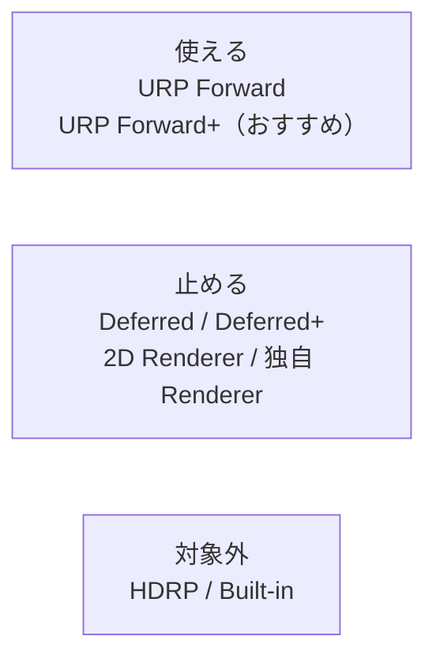

# 限界と対応環境

## 対応環境（0.1）

| もの | 版 |
|---|---|
| Unity | 6000.6 系（6000.6.0f1 以降）。開発と確認は 6000.6.8f1 |
| URP | 17.6.0 |
| Input System | 1.20 系 |
| Unity 7.0（URP 17.7.0） | **未対応**。範囲外の版では警告を出す |

| ビルド先と Graphics API | 扱い |
|---|---|
| Windows（Direct3D 12） | 対応（受け入れ確認済み） |
| Web（WebGPU だけ） | 対応（デモで確認済み） |
| Windows（Direct3D 11）、macOS（Metal）、Linux（Vulkan、OpenGL Core）、ゲーム機 | 未検証（ビルドは止めない） |
| Android、iOS、tvOS、visionOS | 非対応（ビルドを止める） |
| WebGL 2、OpenGL ES 3.0、macOS の OpenGL | 非対応（Shader Model 4.5 未満のため。ビルドを止める） |

Web で動かすときは、WebGPU に対応したブラウザー（Chrome、Edge など）が必要です。

## 描き方の限界

| 限界 | 中身 | どうすればよいか |
|---|---|---|
| Forward での点光源 | 点光源とスポットライトが BRG の物に当たらない（Unity 標準の BRG でも同じ） | Forward+ を使う |
| とても大きな 1 枚の面 | 近くの物を覆ったり、何も映らなくなったりする | 細かく分割する（例：200×200） |
| とても長い物 | 長さ 10²⁴ m 以上の柱、原点から 10⁸ m 以上ずらした頂点、長さ 10⁹ m 以上の傾いた柱は崩れる | 原点から遠い位置は Mesh に焼かず Logical で置く。長い物は分割する |
| 木星・土星級の巨大な球 | 近づくと箱のように角ばって見える | 確立した回避策は無い。既知の限界 |
| 2D（Sprite）と Canvas の UI | Radial にならない | 別のカメラで描いて重ねる |
| DOTS / Entities Graphics | 0.1 では対象外。見つけると切り替えを止める | 別の Scene に分ける |
| 一部のシェーダー | TextMesh Pro の SDF など、昔ながらの固定機能のシェーダーは変換できない | Shader Graph 版を使う、代わりを登録する |
| 光の焼き込み | Lightmap や Light Probe は `float` の位置で計算する | 原点の近く（安全域 1 万 m の内側）で焼く |

## 精度と遊びの限界

| 限界 | 中身 |
|---|---|
| 物理・当たり判定 | Unity のまま。遠くで物理を使う仕組みは無い |
| 回転の欄 | Logical Transform の回転の欄は、Unity の普通の `float` の欄 |
| 性能 | 画面の点ごとの重さは、まだ測っていない |

## デモの限界

| デモ | 限界 |
|---|---|
| Earth | 確かめたのは Edit Mode の撮影だけ。Play Mode、Scene View、Player、WebGPU は未確認。アルプス以外の地形は実在の形ではない。岩は影を落とさない |
| Asteria | 影を作らない設計。夜の通りは Player と Web で未確認で、光の重さが目標に届いていない |

## 確かめていないこと

- Unity 6000.6.8f1 以外の版での変換の再現。
- Direct3D 11、Metal、Vulkan での見た目。
- 製品の描画の回帰確認を WebGPU で通すこと（デモでは確認済み）。
