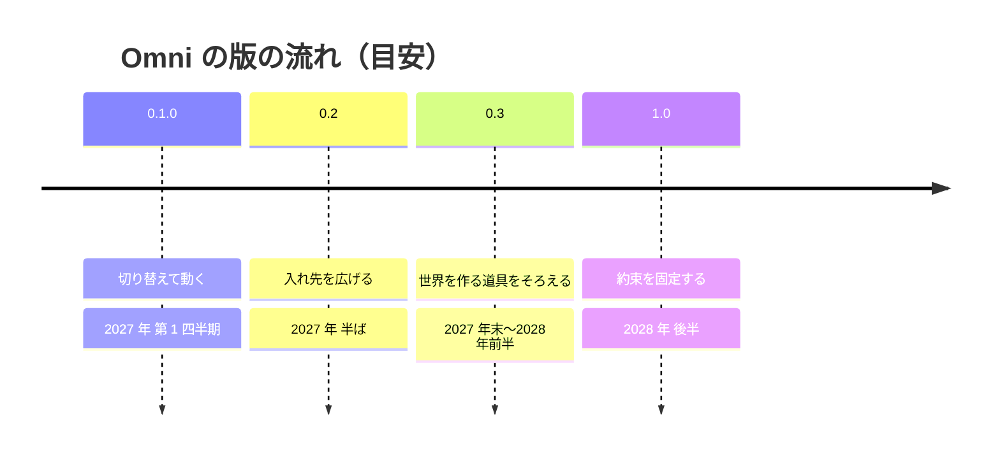

# これから

!!! warning "日付はすべて目安です"
    次の予定は、開発文書『Omni ロードマップ・戦略』（2026-11-14 の案）によります。
    「時期は目安でよい。条件がそろわなければ出さない」は利用者の決定です。目安を過ぎても範囲は削らず、目安の方を書き直します。

## 0.1 「切り替えて動く」

**約束**：Unity 6000.6 + URP の今あるプロジェクトを、ふつうの描画と Radial で行き来でき、間違った絵を出さない。

- 決めてある 13 項目を**全部そろえてから**出す（利用者の決定）。
- VirtualGeometry は本体のパッケージに入れる（利用者の決定）。
- 0.1.x は直しだけで、新しい機能は入れない。

## 0.2 「入れ先を広げる」

**ねらい**：同じ約束を、より多くのプロジェクトで成り立たせる。

| 順 | 入れるもの |
|---|---|
| 1 | Unity 6.7 LTS への対応と、Unity の版ごとの変換器の分離 |
| 2 | URP 6.7 の新機能（画面の反射、陰影など）を、対応するか止めるかを機能ごとに決める |
| 3 | Unity 7 のプレビューで試し、壊れる所の一覧を作る |
| 4 | DOTS / Entities Graphics の Radial 対応 |
| 5 | Direct3D 11、Vulkan、Metal の検証。WebGPU での製品の描画の確認 |
| 6 | 最初の切り替えの速さと、画面の点ごとの重さの計測 |

**出口の条件**：6000.6 で作ったプロジェクトを 6.7 LTS に上げ、生成物を作り直すだけで同じ絵が出る。

## 0.3 「世界を作る道具をそろえる」

- VirtualGeometry の、細かい塊（クラスタ）単位の仕組みへの移行を完了する。地形だけでなく普通の Mesh も。
- データのストリーミング（`.otp` 形式）を正式にする。
- 惑星を置くための部品（高さ、接地、大気など）を、デモの中から製品の部品に切り出す。
- Unity 7 に正式対応する。
- **Asteria を公開デモにする**。
- **Mesh Shader**：Unity が使えるようになっていたら、近傍切り出しをそれに置き換えることを提案する（利用者の指示）。
- Asset Store での公開の準備。

**出口の条件**：デモのコードを写さずに、製品の部品だけで「軌道から地表まで続く惑星」を 1 つ作れる。

## 1.0 「約束を固定する」

- 公開する API（C#、シェーダーの読み込みファイル、保存形式）を一覧にして固める。
- 対応する Unity は「今の LTS と 1 つ前の LTS」。
- Asset Store で公開する。

## 1.0 のあと（需要しだい）

大きな世界での物理と当たり判定、多人数、XR、モバイル、Deferred。HDRP は扱わない方針です。

## Earth デモのこれから

| 段階 | 中身 |
|---|---|
| 次 | 建物などの人工物を VO の段として置く |
| その次 | HUD と Player での受け入れ確認 |
| 完成後 | `Assets/Omni/Demos/` へ移し、EarthToMoon と SolarSystem に部品を移す |

## 見張っていること

| 見張るもの | なぜ |
|---|---|
| Unity の新しい版 | 変換器は URP のシェーダーの文字を書き換えているので、書き方が変わると止まる |
| Unity の「統合レンダラー」 | URP の内側が大きく作り直される見込み（まだ仮説） |
| Unity の DXC 対応の広がり | 交点方式に必要。広がれば、使える環境が増える |
| Unity 本体の倍精度対応 | 出れば Logical の価値の一部が下がる。ただし奥行きの問題（カメラ 1 台）は残る |

## 互換性の考え方

| 守る強さ | 対象 |
|---|---|
| ずっと読める | 利用者が保存したもの（Logical の値、部品、スクリプトの GUID、GUID 台帳） |
| 作り直す前提 | 生成物（`Assets/Radial/`） |
| 1.0 までは変わってよい | C# の公開 API（1 版の猶予つき） |
| 最後の逃げ道 | いつでもふつうの描画へ戻せる |
